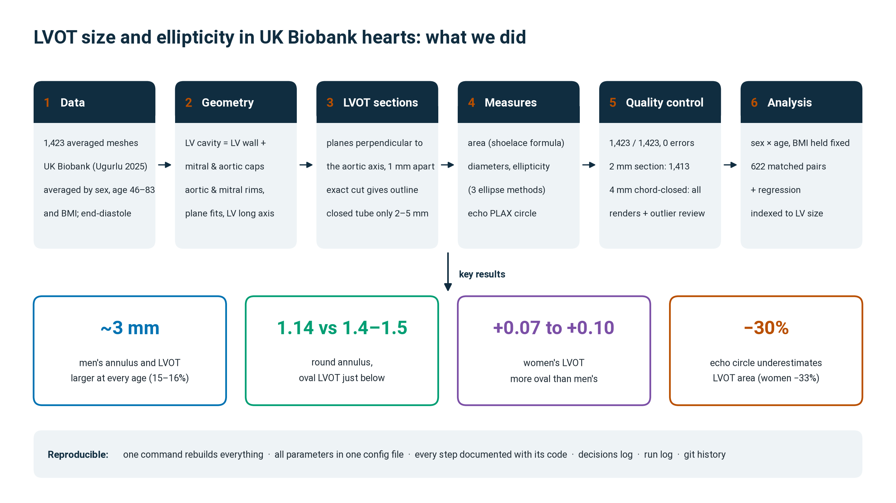
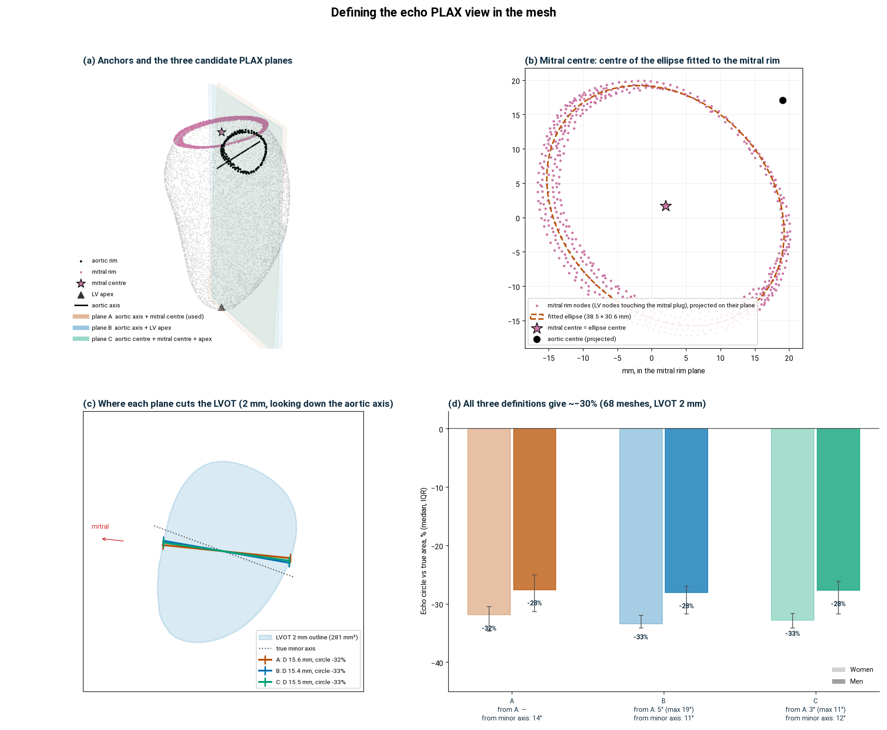
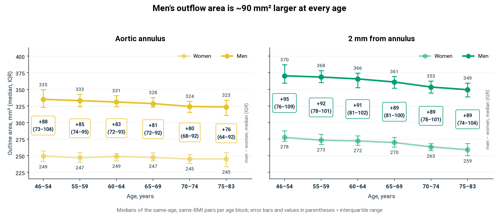
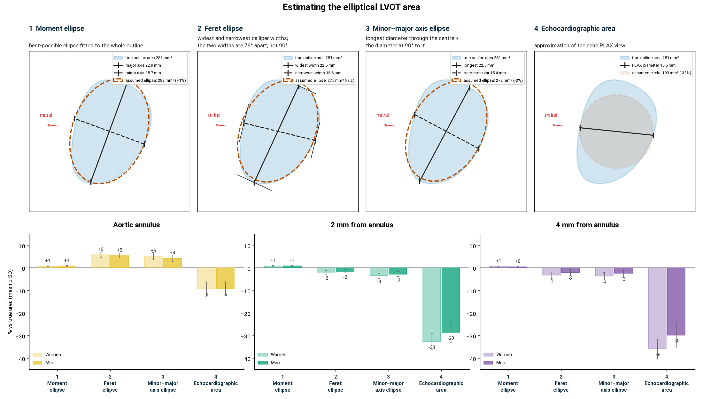

# Figures and the code that makes them

Each figure below lists the script that draws it, the command to run it (from the repository root), and what it needs as input. All scripts read the per-mesh table `outputs/tables/lvot_all.csv`, which `scripts/01_measure.py` builds from the raw meshes (see [README.md](README.md) and [docs/PIPELINE.md](docs/PIPELINE.md) for the full pipeline).

Shared settings live in [`config.yaml`](config.yaml). The house style (Roboto font, level colours, women lighter and men darker) comes from [`assets/fonts/`](assets/fonts) and is set at the top of each figure script.

```bash
PY=python   # Python 3.11 with requirements.txt installed
```

---

## 1. Study flowchart



| | |
|---|---|
| File | [`outputs/figures/project_flowchart.png`](outputs/figures/project_flowchart.png) |
| Code | [`scripts/14_project_flowchart.py`](scripts/14_project_flowchart.py) |
| Run | `$PY scripts/14_project_flowchart.py` |
| Input | `outputs/tables/lvot_all.csv` (all counts are recomputed from it) |
| What it shows | PRISMA-style study flow: 1,423 meshes, processing, eligibility of the 2 mm and 4 mm sections, measurement, analysis (622 matched pairs and the adjusted regression), key results; exclusions on the right |

## 2. Defining the echo PLAX view in the mesh



| | |
|---|---|
| File | [`outputs/figures/analysis/fig_plax_definitions.png`](outputs/figures/analysis/fig_plax_definitions.png) (panel a: anchors and the three candidate PLAX planes) |
| Code | [`scripts/11_plax_definitions.py`](scripts/11_plax_definitions.py) |
| Run | `$PY scripts/11_plax_definitions.py` (68 meshes, ~4 min; needs the raw meshes) |
| Input | raw meshes (`data_dir` in `config.yaml`), `data/labels.csv` |
| What it shows | aortic rim and axis, mitral rim and centre, LV apex, and the three PLAX plane definitions (A aortic axis + mitral centre, used; B aortic axis + apex; C three-point plane); panels b–d show the mitral-centre definition, where each plane cuts the LVOT, and the effect on the echo-circle error |

## 3. LVOT diameter by age


| | |
|---|---|
| File | [`outputs/figures/analysis/fig_size_by_age.png`](outputs/figures/analysis/fig_size_by_age.png) |
| Code | [`scripts/13_size_by_age_figure.py`](scripts/13_size_by_age_figure.py) |
| Run | `$PY scripts/13_size_by_age_figure.py` |
| Input | `outputs/tables/lvot_all.csv`, `outputs/tables/sexdiff_by_age_block.csv` (from `scripts/03_analysis.py`) |
| What it shows | area-derived diameter (2·√(area/π)) of the aortic annulus and the LVOT 2 mm below it, by age group; median and IQR for women and men in the 622 same-age, same-BMI pairs; boxes give the median (IQR) of the paired men − women differences |

## 4. LVOT area by age



| | |
|---|---|
| File | [`outputs/figures/analysis/fig_area_by_age.png`](outputs/figures/analysis/fig_area_by_age.png) |
| Code | [`scripts/13_size_by_age_figure.py`](scripts/13_size_by_age_figure.py) (same script as figure 3) |
| Run | `$PY scripts/13_size_by_age_figure.py --area` |
| Input | as figure 3 |
| What it shows | measured outline area (mm²) instead of diameter, same layout and statistics |

## 5. LVOT ellipticity by method


| | |
|---|---|
| File | [`outputs/figures/analysis/fig_ellipticity_methods.png`](outputs/figures/analysis/fig_ellipticity_methods.png) |
| Code | [`scripts/10_ellipticity_methods.py`](scripts/10_ellipticity_methods.py) |
| Run | `$PY scripts/10_ellipticity_methods.py` |
| Input | `outputs/tables/lvot_all.csv`, `outputs/tables/area_methods_by_mesh.csv` (from `scripts/06_area_methods.py`, which needs `data/outlines/` from `scripts/09_save_outlines.py`) |
| What it shows | ellipticity (major / minor diameter) with three ellipse methods (moment, Feret, minor–major axis) at the annulus, 2 mm and 4 mm, women vs men in the matched pairs; box = IQR, line and number = median, whiskers = 5th–95th percentile. Table: `outputs/tables/ellipticity_methods.csv` |

## 6. Estimating the elliptical LVOT area



| | |
|---|---|
| File | [`outputs/figures/analysis/fig_area_methods_demo.png`](outputs/figures/analysis/fig_area_methods_demo.png) |
| Code | [`scripts/07_area_methods_demo.py`](scripts/07_area_methods_demo.py) (top row and figure), [`scripts/06_area_methods.py`](scripts/06_area_methods.py) (the summary table the bottom row reads) |
| Run | `$PY scripts/06_area_methods.py` then `$PY scripts/07_area_methods_demo.py` (the top row re-reads one mesh, so it needs the raw meshes) |
| Input | `outputs/tables/lvot_all.csv`, `data/outlines/` (from `scripts/09_save_outlines.py`), raw meshes for the example outline |
| What it shows | top: one LVOT outline (woman, 65, BMI 26, 2 mm below the annulus) with the diameters each method uses and the shape it assumes; bottom: mean ± SD % difference from the measured outline area by method, level and sex (matched pairs). Table: `outputs/tables/area_methods_summary.csv` |

---

### Rebuilding everything
`bash run_all.sh` runs the whole pipeline in order. The two long steps (measuring all meshes and saving their outlines, about an hour each) need the raw meshes from Zenodo ([10.5281/zenodo.15649643](https://doi.org/10.5281/zenodo.15649643), CC0) and are resumable. All other figures can be redrawn from the tables already in `outputs/tables/`.
