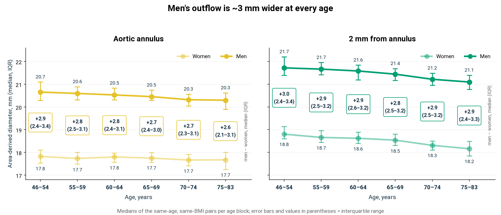
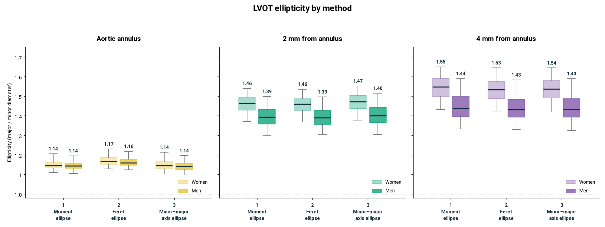
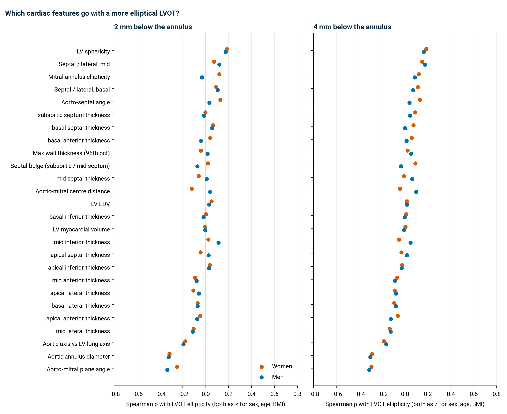
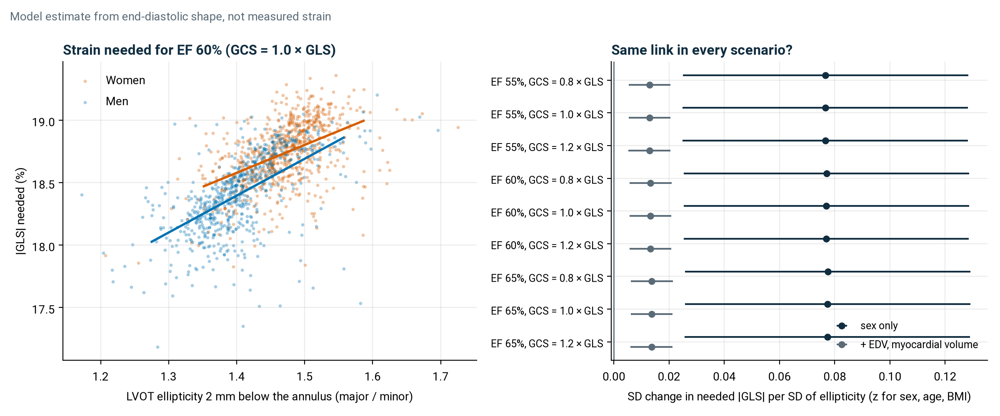
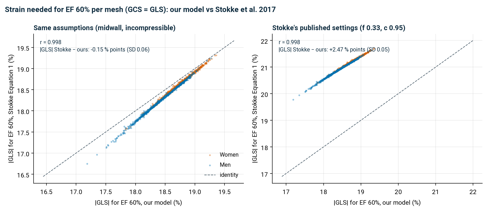
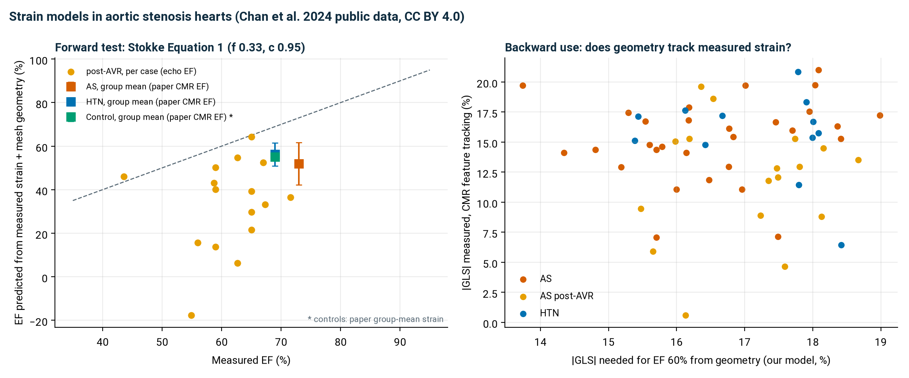
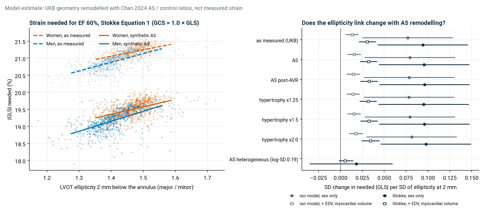

# Figures and the code that makes them

Each figure below lists the script that draws it, the command to run it (from the repository root), and what it needs as input. All scripts read the per-mesh table `outputs/tables/lvot_all.csv`, which `scripts/01_measure.py` builds from the raw meshes (see [README.md](README.md) and [docs/PIPELINE.md](docs/PIPELINE.md) for the full pipeline).

Shared settings live in [`config.yaml`](config.yaml). The house style (Roboto font, level colours, women lighter and men darker) comes from [`assets/fonts/`](assets/fonts) and is set at the top of each figure script.

```bash
PY=python   # Python 3.11 with requirements.txt installed
```

---

## 1. Study flowchart


| | |
|---|---|
| File | [`outputs/figures/project_flowchart.png`](outputs/figures/project_flowchart.png) |
| Code | [`scripts/14_project_flowchart.py`](scripts/14_project_flowchart.py) |
| Run | `$PY scripts/14_project_flowchart.py` |
| Input | `outputs/tables/lvot_all.csv` (all counts are recomputed from it) |
| What it shows | PRISMA-style study flow: 1,423 meshes, processing, eligibility of the 2 mm and 4 mm sections, measurement, analysis (622 matched same-age, same-BMI pairs; the 179 meshes without a partner are not in the sex comparison), key results; exclusions on the right |

## 2. Defining the echo PLAX view in the mesh


| | |
|---|---|
| File | [`outputs/figures/analysis/fig_plax_definitions.png`](outputs/figures/analysis/fig_plax_definitions.png) (panel a: anchors and the three candidate PLAX planes) |
| Code | [`scripts/11_plax_definitions.py`](scripts/11_plax_definitions.py) |
| Run | `$PY scripts/11_plax_definitions.py` (68 meshes, ~4 min; needs the raw meshes) |
| Input | raw meshes (`data_dir` in `config.yaml`), `data/labels.csv` |
| What it shows | aortic rim and axis, mitral rim and centre, LV apex, and the three PLAX plane definitions (A aortic axis + mitral centre, used; B aortic axis + apex; C three-point plane); panels b–d show the mitral-centre definition, where each plane cuts the LVOT, and the effect on the echo-circle error |

## 3. LVOT diameter by age



| | |
|---|---|
| File | [`outputs/figures/analysis/fig_size_by_age.png`](outputs/figures/analysis/fig_size_by_age.png) |
| Code | [`scripts/13_size_by_age_figure.py`](scripts/13_size_by_age_figure.py) |
| Run | `$PY scripts/13_size_by_age_figure.py` |
| Input | `outputs/tables/lvot_all.csv`, `outputs/tables/sexdiff_by_age_block.csv` (from `scripts/03_analysis.py`) |
| What it shows | area-derived diameter (2·√(area/π)) of the aortic annulus and the LVOT 2 mm below it, by age group; median and IQR for women and men in the 622 same-age, same-BMI pairs; boxes give the median (IQR) of the paired men − women differences |

## 4. LVOT area by age


| | |
|---|---|
| File | [`outputs/figures/analysis/fig_area_by_age.png`](outputs/figures/analysis/fig_area_by_age.png) |
| Code | [`scripts/13_size_by_age_figure.py`](scripts/13_size_by_age_figure.py) (same script as figure 3) |
| Run | `$PY scripts/13_size_by_age_figure.py --area` |
| Input | as figure 3 |
| What it shows | measured outline area (mm²) instead of diameter, same layout and statistics |

## 5. LVOT ellipticity by method



| | |
|---|---|
| File | [`outputs/figures/analysis/fig_ellipticity_methods.png`](outputs/figures/analysis/fig_ellipticity_methods.png) |
| Code | [`scripts/10_ellipticity_methods.py`](scripts/10_ellipticity_methods.py) |
| Run | `$PY scripts/10_ellipticity_methods.py` |
| Input | `outputs/tables/lvot_all.csv`, `outputs/tables/area_methods_by_mesh.csv` (from `scripts/06_area_methods.py`, which needs `data/outlines/` from `scripts/09_save_outlines.py`) |
| What it shows | ellipticity (major / minor diameter) with three ellipse methods (moment, Feret, minor–major axis) at the annulus, 2 mm and 4 mm, women vs men in the matched pairs; box = IQR, line and number = median, whiskers = 5th–95th percentile. Table: `outputs/tables/ellipticity_methods.csv` |

## 6. Estimating the elliptical LVOT area


| | |
|---|---|
| File | [`outputs/figures/analysis/fig_area_methods_demo.png`](outputs/figures/analysis/fig_area_methods_demo.png) |
| Code | [`scripts/07_area_methods_demo.py`](scripts/07_area_methods_demo.py) (top row and figure), [`scripts/06_area_methods.py`](scripts/06_area_methods.py) (the summary table the bottom row reads) |
| Run | `$PY scripts/06_area_methods.py` then `$PY scripts/07_area_methods_demo.py` (the top row re-reads one mesh, so it needs the raw meshes) |
| Input | `outputs/tables/lvot_all.csv`, `data/outlines/` (from `scripts/09_save_outlines.py`), raw meshes for the example outline |
| What it shows | top: one LVOT outline (woman, 65, BMI 26, 2 mm below the annulus) with the diameters each method uses and the shape it assumes; bottom: mean ± SD % difference from the measured outline area by method, level and sex (matched pairs). Table: `outputs/tables/area_methods_summary.csv` |

## 7. Slide version: ellipticity by depth and sex (two builds)


| | |
|---|---|
| Files | `outputs/figures/slides/ellipticity_depth_{dark,light}_build{1,2}.png` (dark = transparent, for dark slides) |
| Code | [`scripts/19_ellipticity_depth_slide.py`](scripts/19_ellipticity_depth_slide.py) |
| Run | `$PY scripts/19_ellipticity_depth_slide.py` |
| Input | `outputs/tables/area_methods_by_mesh.csv` |
| What it shows | Two panels (minor–major axis ellipse, same-age, same-BMI pairs). A: ellipticity at the annulus, 2 mm and 4 mm, median and IQR (build 1 pooled, build 2 women vs men). B (build 2 only): paired women − men difference at each level, mean and 95% CI, band = IQR of the pair differences: +0.00 at the annulus, +0.06 at 2 mm, +0.08 at 4 mm |

Ready-made slide using these images: `outputs/slide_ellipticity_animated.pptx` (one slide, on-click build) and `outputs/slide_ellipticity_static.pptx` (two slides). Code: [`scripts/20_ellipticity_slide.js`](scripts/20_ellipticity_slide.js) + [`scripts/20_add_click_build.py`](scripts/20_add_click_build.py).

## 8. Which cardiac features go with a more elliptical LVOT (exploratory)



| | |
|---|---|
| File | [`outputs/figures/analysis/fig_wall_all_feature_map.png`](outputs/figures/analysis/fig_wall_all_feature_map.png) |
| Code | [`scripts/22_wall_geometry.py`](scripts/22_wall_geometry.py) + [`src/wall.py`](src/wall.py) (per-mesh wall thickness and aorto-septal angle), [`scripts/23_wall_phenotypes.py`](scripts/23_wall_phenotypes.py) (figure and phenotype table) |
| Run | `$PY scripts/22_wall_geometry.py --all` (~1.5 h, needs the raw meshes) then `$PY scripts/23_wall_phenotypes.py` |
| Input | `outputs/tables/wall_all.csv`, `lvot_all.csv`, `area_methods_by_mesh.csv` |
| What it shows | Spearman ρ between each feature and LVOT ellipticity, all 1,423 meshes. Every value is first expressed as a z-score for the mesh's sex, age and BMI. Phenotype comparisons: `outputs/tables/wall_all_phenotypes.csv` |

## 9. Strain needed for a given EF, by LVOT ellipticity (model estimate)



| | |
|---|---|
| File | [`outputs/figures/analysis/fig_strain_for_ef.png`](outputs/figures/analysis/fig_strain_for_ef.png) |
| Code | [`scripts/25_strain_for_ef.py`](scripts/25_strain_for_ef.py) |
| Run | `$PY scripts/25_strain_for_ef.py` (seconds) |
| Input | `outputs/tables/lvot_all.csv`, `area_methods_by_mesh.csv`; scenarios in `config.yaml` (`strain_model`) |
| What it shows | Left: the GLS each mesh would need for EF 60% (GCS = GLS), from its end-diastolic shape, against LVOT ellipticity at 2 mm. Right: the slope (z for sex, age and BMI) in every EF and GCS/GLS scenario, before and after adjusting for EDV and myocardial volume. Not measured strain. Tables: `strain_for_ef_by_mesh.csv`, `strain_for_ef_vs_ellipticity.csv` |

**Model check against Stokke et al. 2017** (not a validation against measured strain):



| | |
|---|---|
| File | [`outputs/figures/analysis/fig_strain_model_check.png`](outputs/figures/analysis/fig_strain_model_check.png) |
| Code | [`scripts/26_strain_model_check.py`](scripts/26_strain_model_check.py), equations in [`src/strain.py`](src/strain.py) |
| Run | `$PY scripts/26_strain_model_check.py` (seconds, after script 25) |
| What it shows | The |GLS| each mesh needs for EF 60% (GCS = GLS) from our model vs Stokke's published Equation 1. Left: same assumptions (midwall strain, incompressible wall). Right: Stokke's published settings (strain layer one third into the wall, myocardium 5% compressible). Table: `strain_model_check.csv` |

## 10. Strain models in aortic stenosis hearts (external data)



| | |
|---|---|
| File | [`outputs/figures/analysis/fig_chan2024_strain_check.png`](outputs/figures/analysis/fig_chan2024_strain_check.png) |
| Code | [`scripts/27_chan2024_as_strain.py`](scripts/27_chan2024_as_strain.py) |
| Run | `$PY scripts/27_chan2024_as_strain.py` (seconds; downloads the public data on first run) |
| Input | Chan et al. 2024 public data (FigShare 10.6084/m9.figshare.25428604, CC BY 4.0; please cite doi:10.1161/CIRCIMAGING.123.016489) |
| What it shows | Left: EF predicted by Stokke's Equation 1 from measured CMR feature-tracking strain and each mesh's geometry, against measured EF (per case after AVR; group means for AS, hypertension and controls). Right: |GLS| needed for EF 60% from geometry against measured |GLS|. Tables: `chan2024_by_mesh.csv`, `chan2024_summary.csv` |

---

### Rebuilding everything
`bash run_all.sh` runs the whole pipeline in order. The two long steps (measuring all meshes and saving their outlines, about an hour each) need the raw meshes from Zenodo ([10.5281/zenodo.15649643](https://doi.org/10.5281/zenodo.15649643), CC0) and are resumable. All other figures can be redrawn from the tables already in `outputs/tables/`.

## 11. Synthetic aortic stenosis: strain needed for EF by LVOT ellipticity (model estimate)



| | |
|---|---|
| File | [`outputs/figures/analysis/fig_synthetic_as_strain.png`](outputs/figures/analysis/fig_synthetic_as_strain.png) |
| Code | [`scripts/28_synthetic_as_strain.py`](scripts/28_synthetic_as_strain.py) |
| Run | `$PY scripts/28_synthetic_as_strain.py` (about 35 s; after scripts 25 and 27) |
| Input | `lvot_all.csv`, `area_methods_by_mesh.csv`, `chan2024_by_mesh.csv` (remodelling ratios, Chan et al. 2024, CC BY 4.0) |
| What it shows | Left: |GLS| needed for EF 60% (Stokke Equation 1) against LVOT ellipticity at 2 mm, UKB meshes as measured (faint, dashed) and with AS remodelling applied (solid). Right: ellipticity slope (SD per SD, 95% CI) in each remodelling scenario, both models, unadjusted and adjusted for EDV and myocardial volume. Tables: `synthetic_as_by_mesh.csv`, `synthetic_as_summary.csv` |

