# LVOT ellipticity and CFD from CT

**Question.**
- Echo estimates stroke volume as SV = π·(AP/2)² × VTI. The AP diameter and the PW-Doppler gate are both placed at the LVOT centre.
- The real LVOT is elliptical, and its long axis is mediolateral, which echo can't see.
- So how wrong is echo SV, and how much of the error comes from the **area**, and how much from the **velocity profile**?

**Design.**
1. Measure LVOT shape in the 998 ImageCAS CT scans.
2. Pick 6 matched systolic/diastolic pairs.
3. For each scan, build two CFD "twins":
   - **real**: the patient's actual LVOT.
   - **circle**: a circle of the same area in every slice.
4. Simulate both twins at the same peak flow, then read the velocity a PW gate would see.

---

## 0. Software and data

**Software**
- Python 3.12 through `uv`. Each command lists its own packages with `--with`, so no environment setup is needed.
- Versions used: uv 0.13.7, Python 3.12, Docker Desktop 29.9.3 (macOS arm64). Install OpenFOAM with `docker pull opencfd/openfoam-run:2512`, as in the [OpenFOAM Docker wiki](https://gitlab.com/openfoam/core/openfoam/-/wikis/precompiled/docker).
- Docker Desktop with the image `opencfd/openfoam-run:2512` (OpenFOAM v2512, native arm64), used for the CFD.
- The Docker CLI is at `/Applications/Docker.app/Contents/Resources/bin`. `run_all.sh` adds it to the PATH itself.

**Data, CT**
- ImageCAS: Kaggle `xiaoweixumedicalai/imagecas`, CC BY-NC 4.0. Cite Zeng et al., CMIG 2023.
- Download one chunk at a time (about 18 GB each, needs a Kaggle API token):
  ```bash
  bash get_imagecas_chunk.sh 201-400
  ```
- The chunks unpack to `ImageCAS_<range>/<range>/{id}.img.nii.gz`.

**Data, labels**
- DTU whole-heart labels: Hansen et al., STACOM 2025, arXiv 2510.06090. They are in `labels_DTU/ImageCAS-STACOM2025-02-10-2025/segmentations/`.
- The chamber labels come from TotalSegmentator `heartchambers_highres` and are non-commercial. Do not train other models on them.
- Label values: 1 = myocardium, 2 = LA, 3 = LV, 6 = aorta.
- Cases 90 and 141 have invalid labels and are skipped.

**Licence**
- Non-commercial research only.
- Cite ImageCAS, the DTU labels, TotalSegmentator (Wasserthal 2023), nnU-Net and OpenFOAM.

**Machine limits.** This was all run on a MacBook Air:
- Load one CT at a time.
- Use 4 workers or fewer.
- Run anything longer than about 10 minutes under `caffeinate -i ... > log 2>&1`.

---

## 1. Early exploration (2026-11-10, superseded)
- Prototype LVOT measurement `lvot_cas.py`: LV–aorta interface → valve plane → short-axis slices at 0–12 mm. It was run on chunk 1–200.
  - [imagecas_lvot_geometry_1-200.csv](imagecas_lvot_geometry_1-200.csv), [imagecas_lvot_examples.png](imagecas_lvot_examples.png), [qc_case1.png](qc_case1.png)
- Volumes of all 998 cases: [imagecas_all998_volumes.csv](imagecas_all998_volumes.csv).
- First list of systolic candidates (LV/myocardium volume ratio < 0.6): [candidate_systolic.csv](candidate_systolic.csv).
- Scan of the LVOT posterior border by depth, which led to the curtain rule in step 2:
  - [lvot_border_scan_1-200.csv](lvot_border_scan_1-200.csv), [lvot_border_by_depth.png](lvot_border_by_depth.png)
  - [tracings_53.png](tracings_53.png), [tracings_91.png](tracings_91.png), [tracings_161.png](tracings_161.png)
- Test of rule B on 29 cases: [curtain_end_ruleB_29cases.csv](curtain_end_ruleB_29cases.csv). The rule found the curtain end in 23 of 29 cases.
- *These were exploratory one-off runs, and not all of the plotting code was kept. Step 2 replaces them, so don't use them for results.*

---

## 2. LVOT measurement on all 998 scans: end of the aorto-mitral curtain
Full rule: [README_lvot_curtain.md](README_lvot_curtain.md). Code: [lvot_curtain.py](lvot_curtain.py).

**Method**
1. **Reference plane and LVOT axis.** The LV–aorta label interface gives the reference plane (0 mm), called the "valve plane" here. The LVOT axis is perpendicular to it. This plane is about 1–2 mm above the annulus (see the limitations).
2. **Five long-axis planes** run toward the LA, 2 mm apart.
3. **Wall trace.** In each plane, trace the posterior wall (the curtain, then the anterior mitral leaflet) as the darkest point near the LA edge, with safeguards.
4. **Curtain end.** This is the depth where the wall-to-LA gap starts to open. Each case uses the median over the planes, or the mean when only 2 planes agree.
5. **Short-axis cross-sections** at 2 mm below the label boundary, at mid-curtain and at the curtain end give:
   - area
   - ellipticity (√ of the ratio of the second-moment eigenvalues)
   - equivalent diameter
   - major and minor axes
6. **Exclusion.** Scans whose 2 mm plane still cuts an aortic sinus are excluded: aorta label covers 1% or more of the section, or an aorta-label region of 5 mm² or more lies within 3 mm of it. Script: [sinus_2mm_check.py](sinus_2mm_check.py).

**Run** (about half a day; restartable; 4 workers ≈ 8 GB):
```bash
caffeinate -i uv run --python 3.12 --with nibabel --with scipy --with numpy --with matplotlib \
  python -I lvot_curtain.py \
  --img-dir ImageCAS_1-200/1-200 ImageCAS_201-400/201-400 ImageCAS_401-600/401-600 ImageCAS_601-800/601-800 ImageCAS_801-1000/801-1000 \
  --lab-dir labels_DTU/ImageCAS-STACOM2025-02-10-2025/segmentations \
  --out lvot_out --workers 4
uv run --python 3.12 --with pandas --with numpy --with matplotlib python -I lvot_out/plot_summary.py
caffeinate -i uv run --python 3.12 --with nibabel --with scipy --with numpy python sinus_2mm_check.py --out sinus_2mm_out
uv run --python 3.12 --with pandas --with numpy --with matplotlib python -I lvot_out/summary_sinus_excluded.py
```

**Outputs**
- [lvot_out/lvot_curtain_results.csv](lvot_out/lvot_curtain_results.csv): one row per case.
- `lvot_out/cases/{id}.json`
- `lvot_out/qc/{id}.png`: one per case, showing the five planes, the trace and the curtain end.
- Summary figure, without the excluded scans: 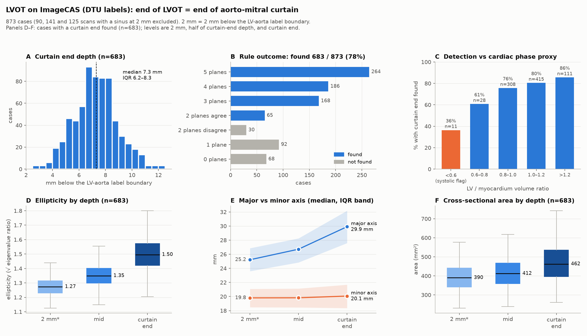
- All scans vs kept scans: [lvot_out/summary_v1_vs_v2.csv](lvot_out/summary_v1_vs_v2.csv). The version-1 figure (all scans) is `lvot_out/lvot_curtain_summary.png`.

**Results**
- 998 cases, 0 errors. 125 are excluded because the 2 mm plane still cuts a sinus, so **873 are analysed**.
- The curtain end was found in 683 of 873 (78%): median 7.3 mm below the label boundary (IQR 6.2–8.3).
- Ellipticity rises with depth: 1.27 at 2 mm, 1.35 at mid-curtain, 1.50 at the curtain end.
- The long axis is mediolateral, and the AP (minor) axis stays at about 20 mm.
- So echo area (π·AP²/4) underestimates true area by a median of 21% at 2 mm, 26% at mid-curtain and 32% at the curtain end.
- The exclusion changes these numbers very little (all 998 scans: curtain end 7.4 mm; ellipticity 1.27 / 1.35 / 1.49; echo error 21 / 25 / 32%).

**Known limit.** In systolic scans the closed mitral leaflet lies against the LA, so the rule usually can't find the curtain end.

---

## 3. CFD case selection: 6 systolic/diastolic pairs
Criteria and exclusions: [cfd/README_case_selection.md](cfd/README_case_selection.md). Code: [cfd/make_case_selection.py](cfd/make_case_selection.py) → [cfd/case_selection.csv](cfd/case_selection.csv).

**Selection**
- Six systolic-flagged scans (LV/myocardium < 0.6).
- Each is paired with a diastolic scan matched on ellipticity and area at 2 mm. The diastolic scan must have the curtain end found in 4–5 planes.
- The pairs:

  | Pair | 1 | 2 | 3 | 4 | 5 | 6 |
  |---|---|---|---|---|---|---|
  | Systolic | 388 | 576 | 33 | 586 | 253 | 146 |
  | Diastolic | 142 | 167 | 978 | 587 | 467 | 663 |
  | Ellipticity at 2 mm | 1.18 | 1.23 | 1.24 | 1.27 | 1.33 | 1.37 |

- *"Pair" here means one systolic scan plus one diastolic scan. Each scan also has its own real/circle CFD twins (step 4), so there are 12 scans and 24 twins in total.*

**QC screening**
- Short-axis CT plus label strips were used to reject scans with artifacts (364, 592, 539, 808; 479 and 29 were replaced).
- Code: [cfd/qc/shortaxis_qc.py](cfd/qc/shortaxis_qc.py). The ID lists used are in its header.
- Run it without `-I`, because it imports `lvot_curtain` from the folder:
  ```bash
  uv run --python 3.12 --with nibabel --with scipy --with numpy --with matplotlib python cfd/qc/shortaxis_qc.py cfd/qc/systolic_shortaxis_1.png 13,33,146,166,253,364,370
  ```
- Outputs: [systolic 1](cfd/qc/systolic_shortaxis_1.png), [systolic 2](cfd/qc/systolic_shortaxis_2.png), [diastolic 1](cfd/qc/diastolic_shortaxis_1.png), [diastolic 2](cfd/qc/diastolic_shortaxis_2.png).

**Caveat.** The systolic scans are **end-systolic**: the valve is closed, so they are not peak ejection.

---

## 4. Twin geometries (real vs same-area circle)
Details: [cfd/README_geometry.md](cfd/README_geometry.md). Code: [cfd/build_twins.py](cfd/build_twins.py), [cfd/summarize_twins.py](cfd/summarize_twins.py), [cfd/qc/montage_twins.py](cfd/qc/montage_twins.py).

**Method**
- Slices are cut perpendicular to the LVOT axis, from 2 to 12 mm, every 0.5 mm.
- **Lumen contour.** 360 rays are cast from the lumen centre. Each stops at the label edge or at the first dark CT run inside the label. This fixes the DTU LV label leaking through the open anterior mitral leaflet. A 25° median filter is applied.
- **circle twin:** in each slice, a circle with the same area and the same centroid.
- Both twins share a straight inlet extension (2 D_eq) and outlet extension (5 D_eq).
- The STLs are watertight and the twin volumes match within 0.04%.
- About 8 s per case.

**Run**
```bash
uv run --python 3.12 --with nibabel --with scipy --with numpy --with scikit-image --with matplotlib python -I cfd/build_twins.py --ids 388,142,576,167,33,978,586,587,253,467,146,663
uv run --python 3.12 --with pandas --with numpy --with trimesh python -I cfd/summarize_twins.py
uv run --python 3.12 --with matplotlib --with numpy python -I cfd/qc/montage_twins.py
```

**Outputs**
- `cfd/geometry/{id}/real.stl`, `circle.stl`, `slices.json`, `qc.png`
- [cfd/twin_geometry_summary.csv](cfd/twin_geometry_summary.csv)
- 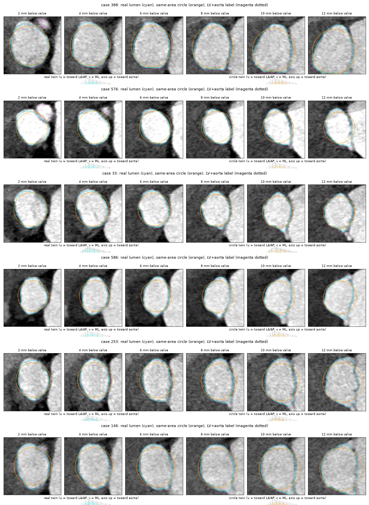
- 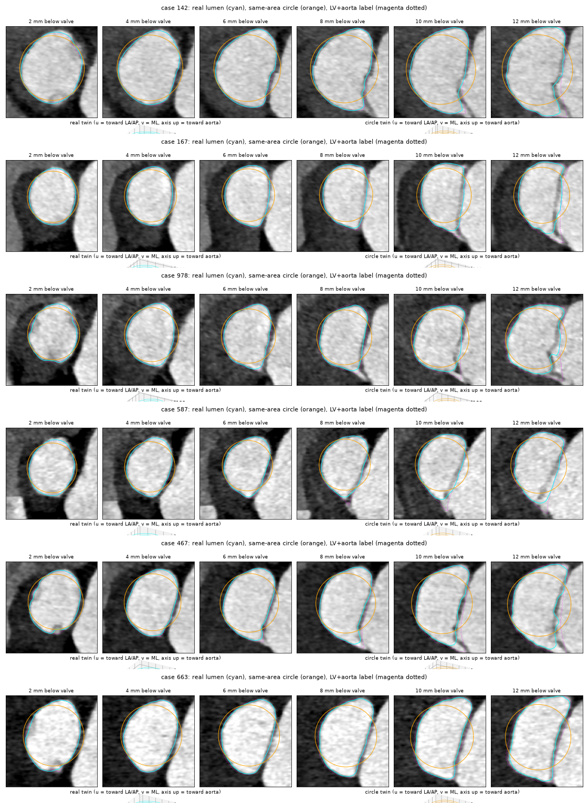

**Result: area part of the echo error alone** (π·AP²/4 vs true area)

| | 5 mm | 7.5 mm | 10 mm |
|---|---|---|---|
| Systolic, median | −24% | −26% | −27% |
| Diastolic, median | −27% | −34% | −37% |

5 and 7.5 mm are the primary depths. 10 mm is secondary, because the contour is less certain near the leaflet tip.

---

## 5. CFD, straight-tube inflow (main run, `lam_h1`)
Details: [cfd/openfoam/README_cfd_run.md](cfd/openfoam/README_cfd_run.md). Code: [cfd/openfoam/](cfd/openfoam/).

**Setup**
- **Solver:** steady simpleFoam, laminar.
- **Flow:** Q = 400 mL/s (peak systole) in every twin. ν = 3.5e-6 m²/s. Re ≈ 6,000.
- **Boundaries:** plug inlet, outlet p = 0, no-slip walls. No leaflets.
- **Mesh:** snappyHexMesh, 1 mm background, 0.5 mm at the wall and in the LVOT, 3 wall layers, about 0.5M cells.
- **PW gate:** the mean axial velocity over the slice centroid plus 6 points on a 1.5 mm ring, at 5, 7.5 and 10 mm.

**Endpoints**
- `area_ratio` = π·AP²/4 ÷ A
- `profile_ratio` = gate velocity ÷ Q/A
- **`SV_ratio` = area_ratio × profile_ratio** (echo SV ÷ true SV)

**Run** (24 cases, about 3.5 h)
```bash
uv run --python 3.12 --with numpy python -I cfd/openfoam/make_cases.py            # all 24 twins → cfd/runs/lam_h1/
caffeinate -i cfd/openfoam/run_all.sh lam_h1 > cfd/runs/lam_h1.log 2>&1
uv run --python 3.12 --with numpy --with pandas python -I cfd/openfoam/postprocess.py --tag lam_h1
uv run --python 3.12 --with numpy --with scipy --with pandas --with matplotlib python -I cfd/openfoam/plane_figures.py --tag lam_h1
uv run --python 3.12 --with numpy --with scipy --with pandas --with matplotlib python -I cfd/openfoam/plane_figures.py --tag lam_h1 --one 978
```

**Outputs**
- [cfd/cfd_results_lam_h1.csv](cfd/cfd_results_lam_h1.csv), [cfd/peak_displacement_lam_h1.csv](cfd/peak_displacement_lam_h1.csv)
- Sections at each depth for all 12 scans: [5 mm](cfd/qc/velocity_sections_lam_h1_d5p0.png), [7.5 mm](cfd/qc/velocity_sections_lam_h1_d7p5.png), [10 mm](cfd/qc/velocity_sections_lam_h1_d10p0.png). One scan at all depths: [978](cfd/qc/velocity_sections_lam_h1_978.png).

**Result**
- All 24 cases converged.
- Echo SV ÷ true SV, real twin:
  - diastolic: 0.81 / 0.71 / 0.71
  - systolic: 0.84 / 0.83 / 0.82 (5 / 7.5 / 10 mm)
- Circle twin: 1.06–1.12.
- Shape effect on the gate velocity (real ÷ circle) is only +1.5–3%. **The area error dominates.**
- The profile is flat with no skew. That's expected, because the plug inlet removes any LV-driven skew.

### 5a. Checks on pair 1 (388/142)
- **Mesh:** a 2.4× finer mesh changes the profile ratio by ≤0.2%.
  ```bash
  uv run --python 3.12 --with numpy python -I cfd/openfoam/make_cases.py --ids 388,142 --h 0.7
  ```
  Run with `run_all.sh lam_h0.7`. Output: [cfd_results_lam_h0.7.csv](cfd/cfd_results_lam_h0.7.csv).
- **Turbulence model:** k-ω SST changes it by ≤0.1%.
  ```bash
  uv run --python 3.12 --with numpy python -I cfd/openfoam/make_cases.py --ids 388,142 --model kOmegaSST
  ```
  Run with `run_all.sh kOmegaSST_h1`. Output: [cfd_results_kOmegaSST_h1.csv](cfd/cfd_results_kOmegaSST_h1.csv).
- So the laminar 1 mm runs are mesh- and model-converged.

---

## 6. CFD with the patient's own LV cavity as inflow (`lv_lam_h1`, `lv_apical_lam_h1`)
Code: [cfd/build_lv_twins.py](cfd/build_lv_twins.py), then `make_cases.py --variant lv` or `--variant lv_apical`.

**Geometry**
- The LV cavity (label 3) is shared by both twins.
- It blends into the twin's LVOT segment over 12–16 mm.
- The LVOT areas match the tube twins within 0.7%.

**Inflow**
- **lv:** uniform through the endocardium deeper than 20 mm and away from the LA. This stands in for wall contraction.
- **lv_apical:** only through the deepest half of the LV, as a sensitivity check.

**Run**
```bash
uv run --python 3.12 --with nibabel --with scipy --with numpy --with scikit-image --with matplotlib python -I cfd/build_lv_twins.py --ids 388,142
uv run --python 3.12 --with nibabel --with scipy --with numpy --with scikit-image --with matplotlib python -I cfd/build_lv_twins.py --ids 388,142 --apical
uv run --python 3.12 --with numpy python -I cfd/openfoam/make_cases.py --ids 388,142 --variant lv
uv run --python 3.12 --with numpy python -I cfd/openfoam/make_cases.py --ids 388,142 --variant lv_apical
caffeinate -i bash -c 'cfd/openfoam/run_all.sh lv_lam_h1 > cfd/runs/lv_lam_h1.log 2>&1; cfd/openfoam/run_all.sh lv_apical_lam_h1 > cfd/runs/lv_apical_lam_h1.log 2>&1'
uv run --python 3.12 --with numpy --with pandas python -I cfd/openfoam/postprocess.py --tag lv_lam_h1        # same for lv_apical_lam_h1
uv run --python 3.12 --with numpy --with scipy --with pandas --with matplotlib python -I cfd/openfoam/plane_figures.py --tag lv_lam_h1 --one 388   # and --one 142
```

**Outputs**
- `cfd/geometry/{id}/{twin}_lv.stl`, `lv_info.json`, `qc_lv.png`
- [cfd_results_lv_lam_h1.csv](cfd/cfd_results_lv_lam_h1.csv), [cfd_results_lv_apical_lam_h1.csv](cfd/cfd_results_lv_apical_lam_h1.csv)
- Figures: [388 LV](cfd/qc/velocity_sections_lv_lam_h1_388.png), [142 LV](cfd/qc/velocity_sections_lv_lam_h1_142.png), [388 apical](cfd/qc/velocity_sections_lv_apical_lam_h1_388.png), [142 apical](cfd/qc/velocity_sections_lv_apical_lam_h1_142.png)
- 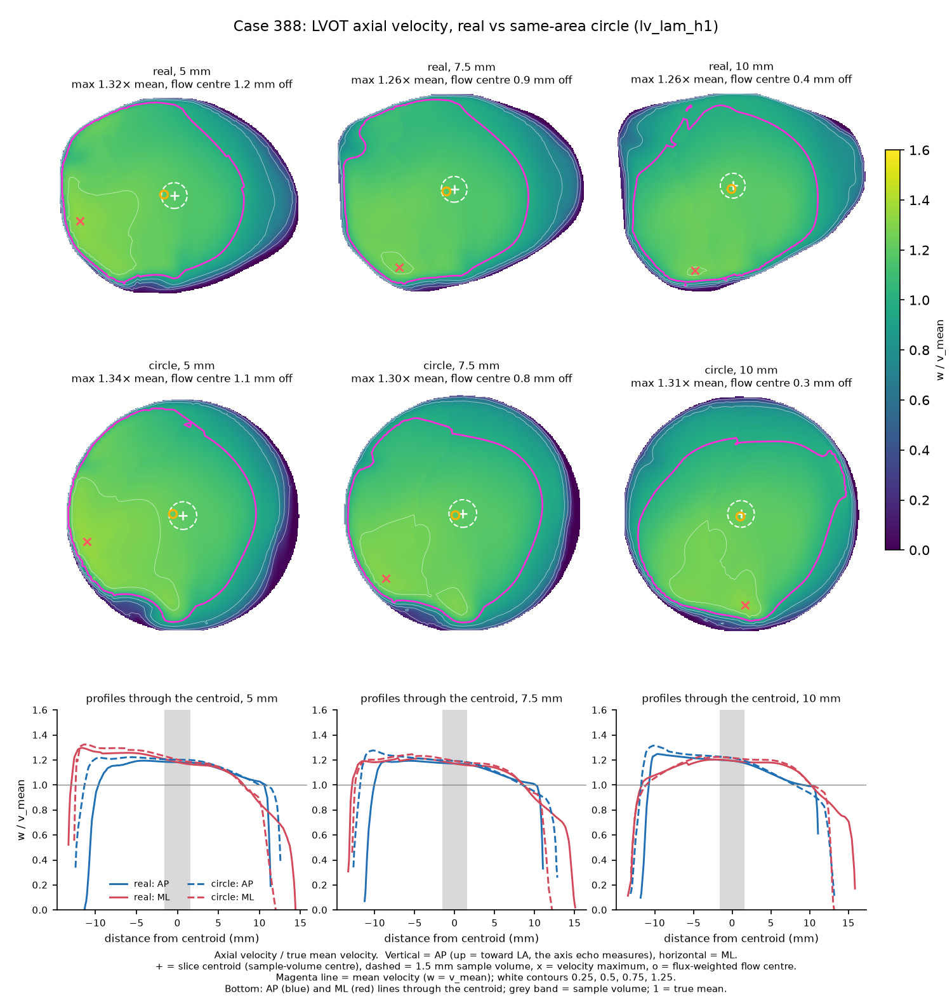

**Result (pair 1)**
- **Area still dominates.** Real-twin SV_ratio:
  - 142: 0.91 / 0.82 / 0.72
  - 388: 0.95 / 0.90 / 0.90
- **LV inflow raises the profile ratio** in both twins, to 1.13–1.21. The flow separates under the curtain on the LA side.
- **The real-vs-circle shape effect shrinks** to 0.98–1.00. So the LV, not the LVOT cross-section shape, sets the skew.
- **Asymmetry in 388:** flow angle 16–21° and secondary flow 40–49%. The asymmetry metrics are flow displacement (Sigovan 2011), flow angle and secondary-flow fraction, all in `peak_displacement_<tag>.csv`.
- **Convergence:** the apical-inflow 388 cases did not converge, so we ran step 7.

---

## 7. Transient check of the unsteady case (`lv_apical_lam_tr_h1`, 388)

**Setup**
- **Solver:** pimpleFoam, constant Q, Δt ≈ 0.085 ms, 0.5 s of physical time.
- **Start:** the steady result.
- **Averaging:** time-averaged from 0.2 s (fieldAverage, with probes every step).

**Run** (about 3 h)
```bash
uv run --python 3.12 --with numpy python -I cfd/openfoam/make_cases.py --ids 388 --variant lv_apical --transient --init-from lv_apical_lam_h1
caffeinate -i cfd/openfoam/run_all.sh lv_apical_lam_tr_h1 > cfd/runs/lv_apical_lam_tr_h1.log 2>&1
uv run --python 3.12 --with numpy --with pandas python -I cfd/openfoam/postprocess.py --tag lv_apical_lam_tr_h1
uv run --python 3.12 --with numpy --with scipy --with pandas --with matplotlib python -I cfd/openfoam/plane_figures.py --tag lv_apical_lam_tr_h1 --one 388 --field UMean
uv run --python 3.12 --with numpy --with pandas --with matplotlib python -I cfd/openfoam/transient_trace.py --tag lv_apical_lam_tr_h1
```

**Outputs**
- [cfd_results_lv_apical_lam_tr_h1.csv](cfd/cfd_results_lv_apical_lam_tr_h1.csv)
- 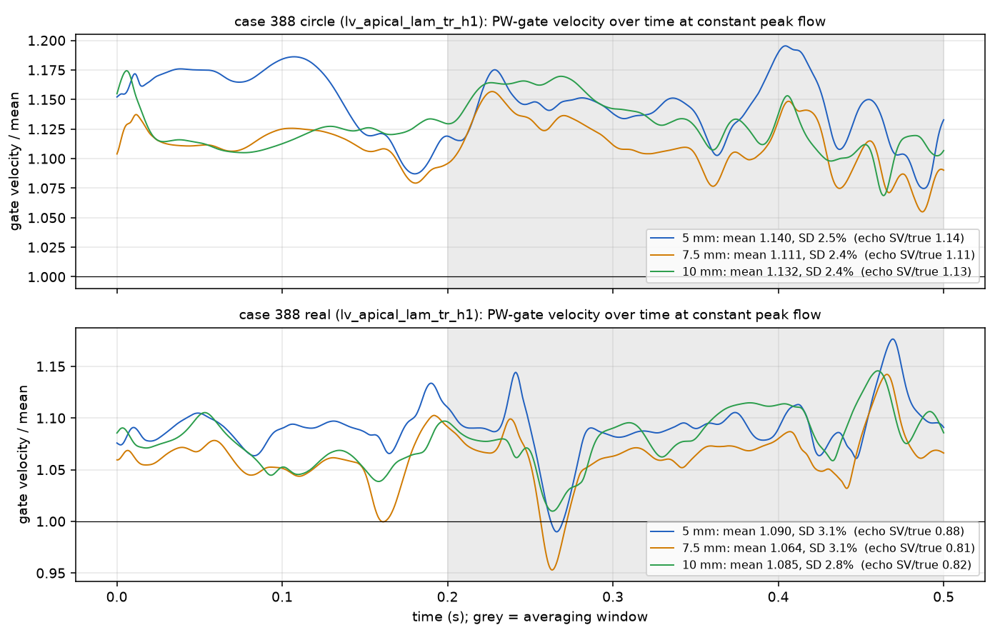
- 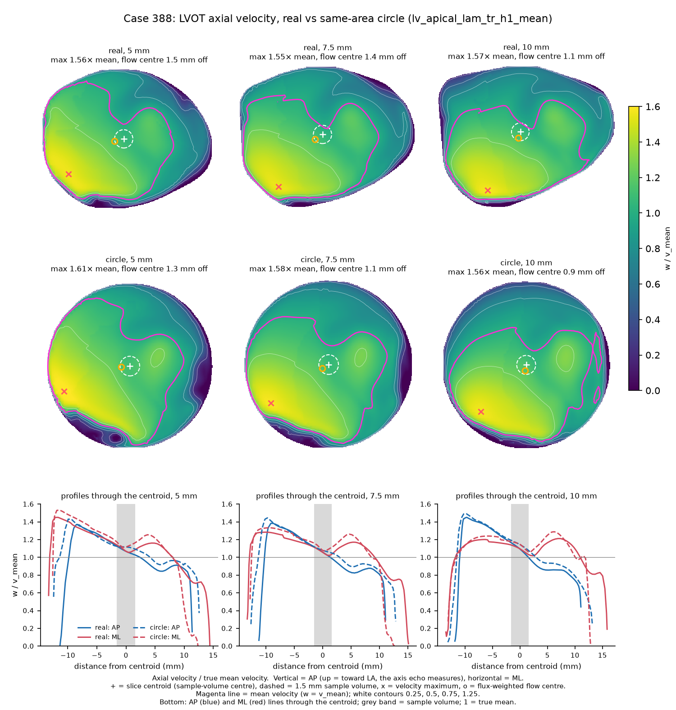

**Result**
- **The flow really is unsteady.** The gate velocity has an SD of 2.4–3.1% and swings by 10–19% peak-to-peak. This is shear-layer instability at Re ≈ 6,000.
- **The time mean is within 1.5% of the steady snapshot.** Echo SV ratio: real 0.88 / 0.81 / 0.82, circle 1.14 / 1.11 / 1.13.
- **Septal jet:** 1.55–1.6× the mean.
- **Implication:** a single beat carries about ±3% noise. The steady results stand.

---

## 8. How to read the cross-section figures (marker key)
Code: [cfd/openfoam/marker_key.py](cfd/openfoam/marker_key.py). It explains the symbols used in every `velocity_sections_*` figure.

**Run** (on any finished case)
```bash
uv run --python 3.12 --with numpy --with scipy --with pandas --with matplotlib python -I cfd/openfoam/marker_key.py --tag lv_lam_h1 --case 388_real --depth 7.5
```

**Output**
- 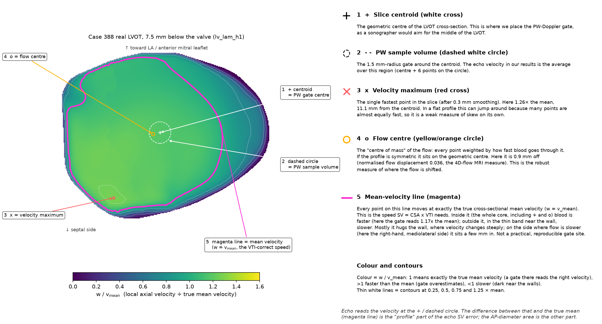

**Symbols**
- **+** = slice centroid, where the PW gate goes. The dashed circle is the 1.5 mm sample volume.
- **x** = velocity maximum.
- **o** = flux-weighted flow centre.
- **Colour** = w / v_mean, the local axial velocity ÷ the true mean.
- **Magenta line** = the 1.0 contour: points moving exactly at the mean velocity, where the gate would read the VTI-correct speed.
- **Thin white lines** = contours at 0.25, 0.5, 0.75 and 1.25 × the mean.

---

## 9. LV inflow for all 12 scans (`lv_lam_h1`, all 6 pairs)

**Run** (24 cases, about 3.5 h; the 142 and 388 cases from step 6 are reused)
```bash
uv run --python 3.12 --with nibabel --with scipy --with numpy --with scikit-image --with matplotlib python -I cfd/build_lv_twins.py --ids 146,167,253,33,467,576,586,587,663,978
uv run --python 3.12 --with numpy python -I cfd/openfoam/make_cases.py --ids 146,167,253,33,467,576,586,587,663,978 --variant lv
caffeinate -i cfd/openfoam/run_all.sh lv_lam_h1 > cfd/runs/lv_lam_h1_all.log 2>&1
uv run --python 3.12 --with numpy --with pandas python -I cfd/openfoam/postprocess.py --tag lv_lam_h1
uv run --python 3.12 --with numpy --with scipy --with pandas --with matplotlib python -I cfd/openfoam/plane_figures.py --tag lv_lam_h1 --one 33   # also --one 576, 388, 142
```

**Outputs**
- [cfd_results_lv_lam_h1.csv](cfd/cfd_results_lv_lam_h1.csv), [peak_displacement_lv_lam_h1.csv](cfd/peak_displacement_lv_lam_h1.csv)
- Sections for all 12 scans: [5 mm](cfd/qc/velocity_sections_lv_lam_h1_d5p0.png), [7.5 mm](cfd/qc/velocity_sections_lv_lam_h1_d7p5.png), [10 mm](cfd/qc/velocity_sections_lv_lam_h1_d10p0.png)
- Single cases: [33](cfd/qc/velocity_sections_lv_lam_h1_33.png), [576](cfd/qc/velocity_sections_lv_lam_h1_576.png), [388](cfd/qc/velocity_sections_lv_lam_h1_388.png), [142](cfd/qc/velocity_sections_lv_lam_h1_142.png)
- 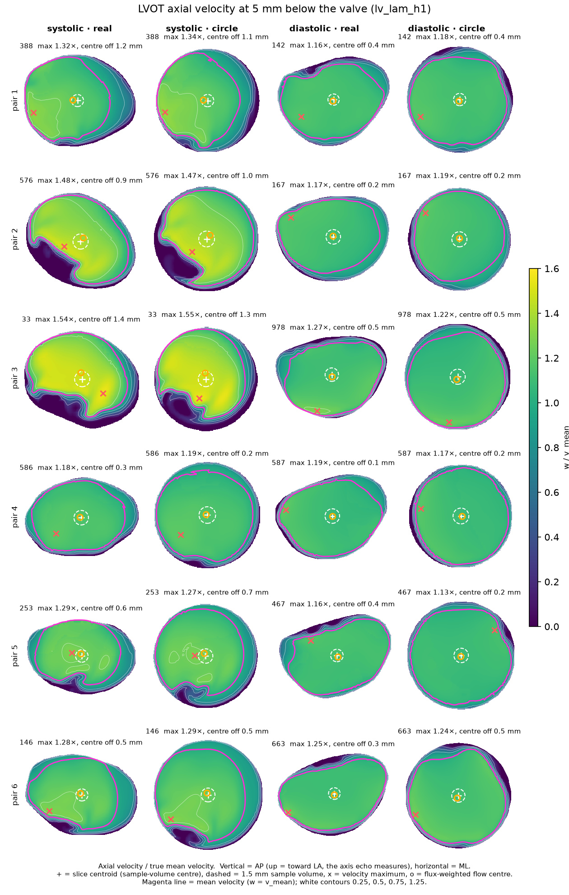

**Result**
- **Convergence:** all 24 cases converged, so no transient reruns are needed.
- **Echo SV ÷ true SV, real twin (median):**
  - diastolic 0.81 / 0.70 / 0.68 (5 / 7.5 / 10 mm), the same as the tube
  - systolic 0.92 / 0.89 / 0.86
- **The real-vs-circle shape effect is gone in every case:** 0.98–1.04.
- **Systolic gate over-read.** In 2 of 6 systolic scans (33 and 576), a large separated zone on the septal side makes the gate read 1.4–1.5× the mean. There, echo overestimates SV at 5–7.5 mm (0.99–1.23).
- **The over-read follows LV size** (Spearman ρ = −0.74 against LV volume). The end-systolic cavity probably exaggerates it, so treat the systolic profile values as an upper bound.

---

## 10. Flow pattern on the long-axis plane (streamlines), case 388
Code: [cfd/openfoam/long_axis_flow.py](cfd/openfoam/long_axis_flow.py). It samples velocity on the A5C-like plane (LVOT axis × AP axis, through the 7.5 mm centroid) and draws in-plane streamlines for three inflow types side by side.

**Run** (on finished cases; a few minutes)
```bash
uv run --python 3.12 --with numpy python -I cfd/openfoam/long_axis_flow.py write --id 388 --twin real
# then in the container, for each of lam_h1, lv_lam_h1 (field U) and lv_apical_lam_tr_h1 (field UMean):
docker run --rm --user "$(id -u):$(id -g)" -v "$PWD/cfd/runs/lv_lam_h1/388_real:/case" -w /case opencfd/openfoam-run:2512 \
  -c "cd /case && postProcess -dict system/sampleLongAxis -latestTime -fields '(U)'"
uv run --python 3.12 --with numpy --with scipy --with matplotlib python -I cfd/openfoam/long_axis_flow.py plot --id 388 --twin real
```

**Output**
- 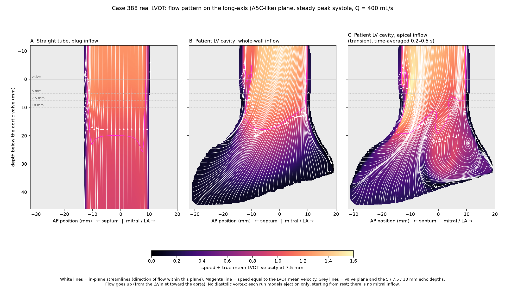

**What it shows**
- **Tube:** straight, parallel flow, with no turning and no skew.
- **Whole-LV inflow:** blood converges from the whole cavity and turns into the LVOT. A thin slow layer forms on the septal side near the valve.
- **Apical inflow:** a fast jet runs along the septum into the LVOT. A large recirculating eddy sits under the anterior mitral leaflet. This is the septal skew seen in the cross-sections.
- **None of these is the physiological diastolic LV vortex.** Each run models ejection only, starting from rest, with no mitral inflow. The eddy in the apical run comes from ejection through this geometry.

---

## 11. 3-D streamlines and particle pathlines

**3-D streamlines (steady or time-averaged flow)**
- Code: [cfd/openfoam/streamlines_3d.py](cfd/openfoam/streamlines_3d.py) and [cfd/openfoam/render_streamlines.py](cfd/openfoam/render_streamlines.py).
- OpenFOAM's `streamLine` function object seeds 250–400 lines on the inflow surface. ParaView 6.2 (`pvbatch`) renders them in an A5C-like view, with the septum on the left.
```bash
uv run --python 3.12 python -I cfd/openfoam/streamlines_3d.py
# per case in the container (field U, or UMean for the transient run):
docker run --rm --user "$(id -u):$(id -g)" -v "$PWD/cfd/runs/lv_lam_h1/388_real:/case" -w /case opencfd/openfoam-run:2512 \
  -c "cd /case && postProcess -dict system/streamLines3D -latestTime -fields '(U)'"
/Applications/ParaView-6.2.0.app/Contents/bin/pvbatch cfd/openfoam/render_streamlines.py
uv run --python 3.12 --with numpy --with matplotlib python -I cfd/openfoam/render_streamlines.py --montage
```
- 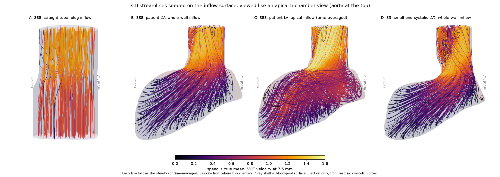

**Particle pathlines (unsteady apical-inflow run, case 388)**
- Code: [cfd/openfoam/make_particle_case.py](cfd/openfoam/make_particle_case.py) and [cfd/openfoam/render_pathlines.py](cfd/openfoam/render_pathlines.py).
- **Method:**
  - The run continues the transient case from t = 0.5 s for 0.15 s.
  - 1,500 tracer particles (20 µm, blood density, so they follow the flow) are released at random positions 2–45 mm below the valve.
  - Positions are saved every ~1 ms (`vtkCloud`). Snapshots are linked into paths by predicting each particle's next position and matching one-to-one (median error 0.001 mm).
  - The original run is not changed.
```bash
uv run --python 3.12 --with numpy --with scipy --with trimesh --with vtk python -I cfd/openfoam/make_particle_case.py --t-run 0.15
caffeinate -i cfd/openfoam/run_all.sh lv_apical_lam_tr_h1_particles > cfd/runs/lv_apical_lam_tr_h1_particles.log 2>&1   # ~21 min
uv run --python 3.12 --with numpy --with scipy --with vtk python -I cfd/openfoam/render_pathlines.py build
/Applications/ParaView-6.2.0.app/Contents/bin/pvbatch cfd/openfoam/render_pathlines.py render
uv run --python 3.12 --with numpy --with matplotlib python -I cfd/openfoam/render_pathlines.py montage
```
- 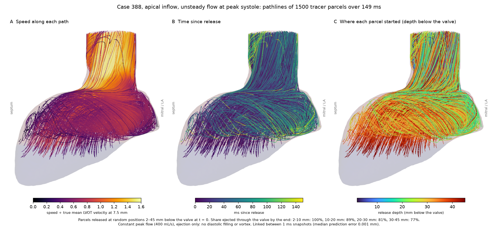

**Result**
- Blood near the valve leaves at once: all parcels released 2–10 mm below the valve cross it within about 8 ms.
- Deeper blood circulates first. Parcels from 20–45 mm loop through a large helical vortex in the LV before they turn into the LVOT along the septum. Their median time to the valve is 50–70 ms.
- After 150 ms, 77–89% of the parcels from 10–45 mm have been ejected. The rest are still circulating, mainly in the eddy under the anterior mitral leaflet.
- This vortex is produced by ejection through this geometry. It is not the diastolic filling vortex, which is not modelled.

---

## 12. Emulated PW-Doppler spectral read-out (modal and maximum velocity, not the spatial mean)
**Why.** Huh et al. (Int J Cardiovasc Imaging 2022;38:1815–23; same-day echo vs 4D-flow MRI) found echo LVOT area 25% too low and VTI 29% too high, with SV about equal (+4%). Our gate so far took the spatial mean over the centroid plus a 1.5 mm ring. Clinicians trace the modal velocity (the densest band of the spectrum) or its outer edge, which can sit higher.

**Code:** [cfd/openfoam/echo_spectrum.py](cfd/openfoam/echo_spectrum.py) and [cfd/openfoam/echo_spectrum_sample.sh](cfd/openfoam/echo_spectrum_sample.sh). Post-processing only; no new solver runs.

**Gate model**
- Centred on the slice centroid at 5, 7.5 and 10 mm, with the beam along the LVOT axis.
- 4 mm long range gate with uniform weighting.
- Gaussian beam profile, FWHM 3 mm, truncated at 2.5 mm radius.
- Velocity sampled every 0.25 mm (about 5,400 points per gate) with OpenFOAM `sets` (`cloud`, cellPoint interpolation).

**Spectrum and read-outs**
- Spectrum: a volume-weighted histogram of the velocity along the beam, in 2 cm/s bins.
- Read-outs:
  - **mean:** the weighted mean
  - **modal:** the peak of the spectrum (3-bin smoothed)
  - **max:** the weighted 97.5th percentile
- Beam angle: 0°, ±10° and ±20° tilt in the A5C plane, with no angle correction.

**Run** (48 cases, about 3 min)
```bash
uv run --python 3.12 --with numpy python -I cfd/openfoam/echo_spectrum.py write --tags lam_h1,lv_lam_h1
bash cfd/openfoam/echo_spectrum_sample.sh lam_h1 lv_lam_h1
uv run --python 3.12 --with numpy --with scipy --with pandas --with matplotlib python -I cfd/openfoam/echo_spectrum.py analyse --tags lam_h1,lv_lam_h1
```

**Outputs**
- [echo_spectrum_lam_h1.csv](cfd/echo_spectrum_lam_h1.csv), [echo_spectrum_lv_lam_h1.csv](cfd/echo_spectrum_lv_lam_h1.csv), [echo_spectrum_summary.csv](cfd/echo_spectrum_summary.csv)
- 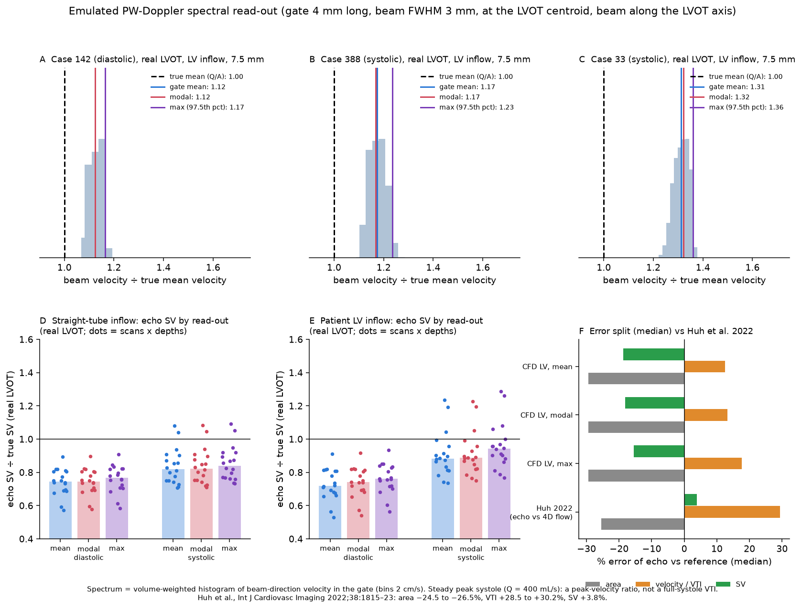

**Result (real LVOT, LV inflow, median at 5 / 7.5 / 10 mm)**

| Read-out | Diastolic gate ÷ mean | Diastolic echo SV ÷ true | Systolic gate ÷ mean | Systolic echo SV ÷ true |
|---|---|---|---|---|
| mean | 1.11 / 1.08 / 1.07 | 0.81 / 0.70 / 0.68 | 1.24 / 1.23 / 1.20 | 0.92 / 0.89 / 0.86 |
| modal | 1.12 / 1.09 / 1.11 | 0.82 / 0.72 / 0.70 | 1.24 / 1.23 / 1.21 | 0.92 / 0.89 / 0.87 |
| max | 1.15 / 1.12 / 1.15 | 0.84 / 0.74 / 0.73 | 1.29 / 1.31 / 1.27 | 0.96 / 0.94 / 0.93 |

**What it shows**
- **The modal velocity is almost the same as the mean** (0–4% higher). Inside a 3–4 mm gate in the LVOT core the velocity is nearly uniform, so the spectrum is narrow (about ±5%) and its peak sits at the mean.
- **The maximum adds only 3–8%.**
- **Changing the read-out does not reproduce Huh's +29% VTI.** With the spectral maximum, echo SV still underestimates by 4–27% (median 0.85 with LV inflow), because the area error (−25 to −35%) is not offset.
- **Beam angle:** ±10° changes echo SV by ≤ 4%, and ±20° by up to −10% (a cosine loss plus moving across the skewed profile).
- **Possible reasons for the gap with Huh, to be checked:**
  1. Steady peak flow, not a full-systole VTI. The profile in early and late systole may be more skewed.
  2. 4D-flow MRI underestimates velocity and VTI (partial volume, temporal averaging), so part of Huh's VTI difference may be on the MRI side.
  3. No intrinsic spectral broadening (finite transit time and aperture). Real spectra are wider, which raises a traced outer edge but not the mode.
  4. No valve leaflets, and a rigid wall.
  5. Gate depth: clinicians often sample nearer the annulus.
  Reason 1 is tested in step 14.

## 13. Enlarged-LV sensitivity: is the systolic over-read caused by the small LV? (`lv_big_lam_h1`)
**Why.** With LV inflow the gate over-reads much more in systolic scans (max +31%) than in diastolic ones (+15%). Systolic scans have small (end-systolic) LV cavities, but they also have a different LVOT. This test keeps each systolic LVOT unchanged and grows only its LV cavity to 88 mL, the median diastolic volume.

**How the LV is grown** ([cfd/build_lv_twins.py](cfd/build_lv_twins.py), `--grow-to`)
- The LV wall is moved outward by an offset that is zero at the valve and full from 28 mm below it (linear taper from 16 to 28 mm). So the LVOT and the first 16 mm stay exactly as segmented.
- The offset is found by bisection so that the cavity holds 88 mL (offsets 5.1–10.9 mm). The twin cross-sections at 5–10 mm match the originals within 0.6%.
- Each case also gets a QC image `cfd/geometry/<id>/qc_lv_big.png` and its settings in `lv_info_big.json`.

**Run** (12 cases, steady, about 2 h; the solver run is a `caffeinate` command for the user)
```bash
uv run --python 3.12 --with nibabel --with scipy --with numpy --with scikit-image --with matplotlib python -I cfd/build_lv_twins.py --ids 388,576,33,586,253,146 --grow-to 88
uv run --python 3.12 --with numpy python -I cfd/openfoam/make_cases.py --ids 388,576,33,586,253,146 --variant lv_big
caffeinate -i cfd/openfoam/run_all.sh lv_big_lam_h1 > cfd/runs/lv_big_lam_h1.log 2>&1
uv run --python 3.12 --with numpy --with pandas python -I cfd/openfoam/postprocess.py --tag lv_big_lam_h1
uv run --python 3.12 --with numpy python -I cfd/openfoam/echo_spectrum.py write --tags lv_big_lam_h1
bash cfd/openfoam/echo_spectrum_sample.sh lv_big_lam_h1
uv run --python 3.12 --with numpy --with scipy --with pandas --with matplotlib python -I cfd/openfoam/echo_spectrum.py analyse --tags lam_h1,lv_lam_h1,lv_big_lam_h1
uv run --python 3.12 --with numpy --with pandas --with matplotlib python -I cfd/openfoam/lv_big_compare.py
```
All 12 runs converged (probe swing over the last 200 iterations ≤ 1%).

**Outputs**
- [cfd_results_lv_big_lam_h1.csv](cfd/cfd_results_lv_big_lam_h1.csv), [echo_spectrum_lv_big_lam_h1.csv](cfd/echo_spectrum_lv_big_lam_h1.csv)
- 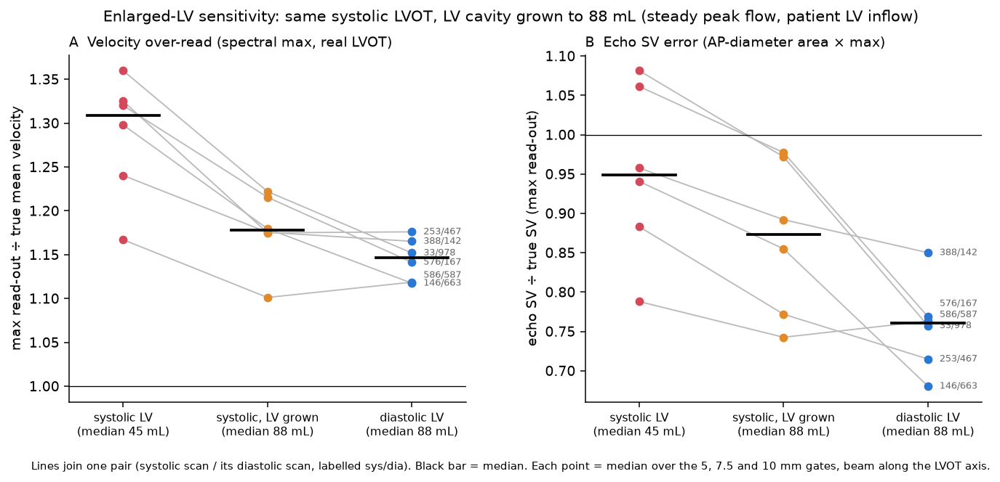

**Result (real LVOT, spectral max, median of the 6 systolic scans, each the median over 5 / 7.5 / 10 mm)**

| | LV volume | Gate max ÷ mean | Echo SV ÷ true |
|---|---|---|---|
| Systolic, LV as segmented | 45 mL | 1.31 | 0.95 |
| Same systolic LVOT, LV grown | 88 mL | 1.18 | 0.87 |
| Paired diastolic scan | 88 mL | 1.15 | 0.76 |

**What it shows**
- **LV size explains most (about 80%) of the systolic–diastolic difference in over-read.** Growing the LV alone drops the over-read from +31% to +18%, close to the diastolic +15%. In every pair the over-read fell. The biggest drops were in the smallest LVs (33: 1.36 → 1.22; 253: 1.33 → 1.18).
- **The rest of the SV difference comes from the area.** The systolic AP-diameter area is less underestimated (area ratio about 0.75 vs 0.67 diastolic), so echo SV stays nearer to true in systolic scans even with a large LV.
- The circle twins moved the same way, so the LVOT shape effect stays small.

## 14. Pulsatile systole: full-beat VTI instead of steady peak flow (`lv_lam_pulse_h1`)
**Why.** All runs so far use constant peak flow, so they give a peak-velocity ratio, not a VTI. The profile may be more skewed in early and late systole (reason 1 in step 12).

**Set-up** ([cfd/openfoam/make_cases.py](cfd/openfoam/make_cases.py) `--pulse`)
- pimpleFoam, one systole from rest, patient LV inflow (`lv` variant, mesh copied from `lv_lam_h1`).
- Flow waveform: raised-cosine rise to Q = 400 mL/s at 110 ms, raised-cosine fall to 0 at 330 ms (SV 66 mL).
- The PW gate of step 12 is sampled during the run every 1 ms (`system/echoGateFO`). The ring probes are written every time step.
- Cases: pair 1, 142 (diastolic) and 388 (systolic), real and circle twins.

**VTI analysis** ([cfd/openfoam/pulse_vti.py](cfd/openfoam/pulse_vti.py))
- For each 1 ms snapshot, the spectral mean, modal and max (step 12) and the true mean velocity Q(t)/A.
- VTI = the time integral over ejection. VTI ratio = read-out VTI ÷ true VTI. SV ratio = area ratio × VTI ratio.
- Cross-check: the ring-probe VTI agrees with the gate-mean VTI within 1%.

**Run** (4 cases, about 1.5 h)
```bash
uv run --python 3.12 --with numpy python -I cfd/openfoam/make_cases.py --ids 388,142 --variant lv --pulse --init-from lv_lam_h1
uv run --python 3.12 --with numpy python -I cfd/openfoam/echo_spectrum.py write --tags lv_lam_pulse_h1 --runtime 0.001
caffeinate -i cfd/openfoam/run_all.sh lv_lam_pulse_h1 > cfd/runs/lv_lam_pulse_h1.log 2>&1
uv run --python 3.12 --with numpy --with scipy --with pandas --with matplotlib python -I cfd/openfoam/pulse_vti.py
```

**Outputs**
- [pulse_vti_lv_lam_pulse_h1.csv](cfd/pulse_vti_lv_lam_pulse_h1.csv) (one row per case and depth) and [pulse_vti_timeseries_lv_lam_pulse_h1.csv](cfd/pulse_vti_timeseries_lv_lam_pulse_h1.csv)
- 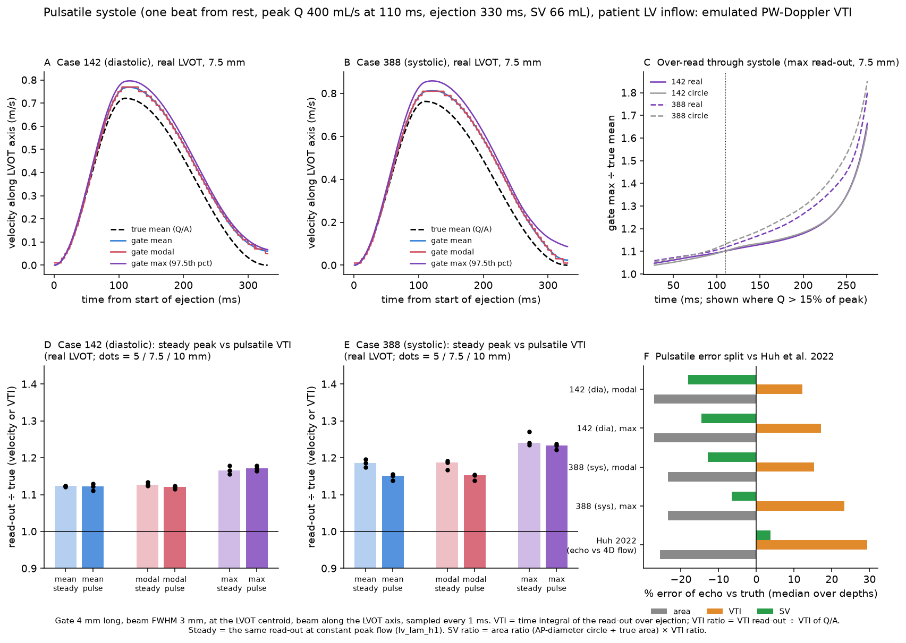

**Result (real LVOT, 5 / 7.5 / 10 mm)**

| Case | Read-out | Steady peak ratio | Pulsatile, at peak flow | Pulsatile VTI ratio | Echo SV ÷ true |
|---|---|---|---|---|---|
| 142 diastolic | mean | 1.13 / 1.12 / 1.12 | 1.06 / 1.06 / 1.06 | 1.13 / 1.12 / 1.11 | 0.92 / 0.82 / 0.71 |
| 142 diastolic | max | 1.16 / 1.17 / 1.18 | 1.09 / 1.10 / 1.12 | 1.16 / 1.17 / 1.18 | 0.94 / 0.86 / 0.75 |
| 388 systolic | mean | 1.19 / 1.17 / 1.20 | 1.07 / 1.06 / 1.07 | 1.16 / 1.14 / 1.15 | 0.93 / 0.87 / 0.87 |
| 388 systolic | max | 1.24 / 1.24 / 1.27 | 1.12 / 1.12 / 1.15 | 1.24 / 1.22 / 1.23 | 1.00 / 0.93 / 0.93 |

The modal read-out lies between the mean and max, as in step 12.

**What it shows**
- **The over-read changes through systole.** While the flow accelerates the profile is flatter, and the gate reads only 5–12% above the mean at peak flow. During deceleration the core keeps moving while flow near the wall slows or reverses, so the over-read climbs to 1.6–1.8 late in ejection (panel C). The gate still reads 2–9 cm/s at end-ejection, when the net flow is zero.
- **Over a whole beat these effects balance out.** The pulsatile VTI ratio is within 0–4% of the steady peak-flow ratio. So the steady runs were a fair stand-in for VTI.
- **The beat still does not reach Huh's +29%.** The pulsatile max VTI is +17% (diastolic) and +23% (systolic), so echo SV still underestimates by 7–25%.
- **Real ≈ circle** for the pulsatile VTI too (the circle twins read 0–3% higher).

---

## Main conclusions so far
1. **The real LVOT is elliptical** with its long axis mediolateral. The echo AP diameter misses the long axis, so echo area is 21–37% too small. This is the main source of echo SV error.
2. **The velocity profile partly offsets it.** The gate reads 6–21% above the mean in most scans. With realistic LV inflow, small (end-systolic) LV cavities push this to 40–50%. The net echo SV ratio is about 0.7–0.95 for the real LVOT. In 2 of 12 scans (small systolic LVs) echo overestimates SV near the valve.
3. **The LVOT shape itself barely changes the profile.** With LV inflow, real vs circle differs by ≤4% in all 12 scans. The LV inflow sets the skew, which points to the septal side and matches Tsujino 2001.
4. **The results are robust** to mesh, turbulence model and unsteadiness (≤1.5% on the mean, with ±3% beat-to-beat noise).
5. **The large over-read in systolic scans is mainly an LV-size effect.** Growing the systolic LV to diastolic size brings the over-read most of the way down (+31% → +18%, vs +15% diastolic).
6. **Steady peak flow is a fair stand-in for the full-beat VTI** (within 4%). The emulated spectral read-out (max VTI +17–23%) does not reach the +29% VTI that Huh et al. 2022 found against 4D flow, so echo SV still underestimates in our model.

## Limitations
- Rigid walls and no valve leaflets.
- Constant peak flow in most runs. The pulsatile check (step 14) covers only one pair and one idealised waveform from rest.
- Uniform LV-wall inflow.
- The LV cavity is the traced LV contour, which includes the papillary muscles and trabeculae (the standard way to trace the LV). The LV-inflow runs treat all of it as blood. In the 6 systolic scans, 16–21% of the traced cavity is muscle and not blood (6–10% in the 6 diastolic scans; a CT threshold, counted more than about 1 mm inside the contour). So the model cavity is larger and smoother than the real blood pool, mostly deep in the ventricle. The LVOT segment (2–12 mm) is not affected.
- No diastolic filling or LV vortex: each run models ejection only, starting from rest, so it has no memory of the diastolic vortex.
- No in-vivo flow validation.
- End-systolic rather than peak-ejection geometry.
- A small pilot: 6 pairs.
- **The reference plane (0 mm) is not the annulus.** It is the LV–aorta label boundary, which crosses the closed cusps and sinus floors. It is about 1–2 mm above the annulus (automatic estimate: median 1.6 mm, not checked against hand marks). So "2 mm" is close to the annulus level, and all other depths (mid-curtain, curtain end, the CFD read-outs at 5, 7.5 and 10 mm) are measured from a level above the annulus. The curtain-end cross-section itself is not affected.
- **Scans with a sinus at 2 mm are excluded** from the CT analysis: 125 of 998 (13%), including 3 of the 14 systolic-flagged scans. If these hearts differ (for example, a lower annulus), the kept scans are not fully representative.
- **Two CFD scans meet the exclusion rule:** 576 (pair 2, a sinus beside the lumen) and 663 (pair 6, a sinus tip at exactly the 1% cut-off). The sinus is not in either CFD lumen, because the CFD geometry starts at 2 mm and the outlet repeats the 2 mm slice.
- **Possible later fix (not done):** find the annulus in each scan from the three cusp nadirs in 3-D multiplanar reconstruction (MPR) and measure all depths from it. An automatic estimate is in `annulus_offset.py`. It was not validated, because the annulus cannot be marked reliably on fixed slices.
