# LVOT ellipticity: how to reproduce every result and figure

This file lists all the work done for the report (STEPS 0–9). For each step, it gives what the step does, the code, the command, the outputs and the figure.

- **Scope:** the final report covers STEPS 0–9 only.
- **More detail:** method per sub-step in [`docs/PIPELINE.md`](docs/PIPELINE.md); reason for each choice in [`docs/DECISIONS.md`](docs/DECISIONS.md); results and caveats in [`WRITEUP.md`](WRITEUP.md).

---

## Set-up

1. **Get the data.**
   - Download the 1,423 representative biventricular meshes from Zenodo: [doi:10.5281/zenodo.15649643](https://doi.org/10.5281/zenodo.15649643) (CC0). Cite Ugurlu et al., PLoS One 2025.
   - Unzip them. Set `data_dir` in [`config.yaml`](config.yaml) to that folder.
   - Each mesh is the average of the UK Biobank participants with the same sex, age (46–83) and integer BMI.
2. **Make the Python environment** (Python 3.11, exact versions in [`requirements.txt`](requirements.txt)):
   ```bash
   python3.11 -m venv .venv && .venv/bin/pip install -r requirements.txt
   ```
3. **Set the interpreter** for the commands below:
   ```bash
   PY=.venv/bin/python
   ```
4. **Run everything in order** (about 4 hours in total; all long steps can be resumed):
   ```bash
   caffeinate -i bash run_all.sh > outputs/logs/run_all.log 2>&1
   ```
   `caffeinate` is for macOS. On Linux, run `bash run_all.sh` without it.
5. **Without the meshes:** the per-mesh tables are in `outputs/tables/`. The steps marked "tables only" redraw their figures from these tables. The steps marked "needs meshes" need the raw data.
6. **Provenance:** each script run adds one line to `outputs/logs/runs.jsonl`, with the time, arguments, code hash, config hash and package versions.

| Item | Where |
|---|---|
| All parameters | [`config.yaml`](config.yaml) |
| Measurement code | [`src/lvot.py`](src/lvot.py) (STEPS 1–5), [`src/wall.py`](src/wall.py) (STEP 9) |
| Scripts | [`scripts/`](scripts) (numbered in the order they were written; run order is in `run_all.sh`) |
| Step markers | every step is marked `# STEP x.y` in the code |
| Font for figures | Roboto, in [`assets/fonts/`](assets/fonts) (Apache 2.0) |

---

## STEP 0 — List the meshes (needs meshes)

- **What it does:** finds every mesh file and reads sex, age and BMI from the folder name.
- **Code:** [`scripts/00_labels.py`](scripts/00_labels.py)
- **Run:** `$PY scripts/00_labels.py`
- **Output:** `data/labels.csv`
- **Check:** 1,423 meshes (761 women, 662 men), ages 46–83, and 622 women–men pairs with the same age and BMI.

## STEPS 1–5 — Measure each mesh (needs meshes)

- **What they do,** for each mesh:
  - **STEP 1:** read the tetrahedral mesh and convert µm to mm.
  - **STEP 2:** find the LV cavity (one of 3 closed surfaces) and the LV endocardium. The cavity volume is the LV end-diastolic volume. No UVCs are used.
  - **STEP 3:** find the aortic and mitral rings (LV nodes shared with the valve plugs), fit a plane, and measure the annulus outline: area, perimeter, moment-ellipse diameters, ellipticity and calliper (Feret) diameters. Also measure the aorto-mitral angle, the LV length and the echo-style (PLAX) diameter.
  - **STEP 4:** cut exact cross-sections perpendicular to the aortic axis, 0–15 mm below the annulus. The **primary LVOT** is the closed section at **2 mm**. The **secondary LVOT** is at **4 mm**, where the open mitral side is closed with a straight chord (gap ≤ 120°).
  - **STEP 5:** set QC flags and write one row per mesh.
- **Code:** `measure_mesh()` in [`src/lvot.py`](src/lvot.py), called by [`scripts/01_measure.py`](scripts/01_measure.py)
- **Run:**
  ```bash
  $PY scripts/01_measure.py --subset      # 8-mesh test subset, a few seconds
  $PY scripts/01_measure.py --all         # all 1,423 meshes, about 70 min, resumable
  ```
- **Output:** `outputs/tables/lvot_all.csv` (one row per mesh; errors to `lvot_all_errors.csv`)
- **Check:** 1,423 of 1,423 meshes, 0 errors. All have 3 surface components. The 2 mm section is missing in 10 meshes (closed tube only to 1 mm).

### STEP 5.2–5.5 — QC and method pictures (needs meshes)

- **QC render per mesh** (en-face and side view):
  - Code: [`scripts/02_qc_render.py`](scripts/02_qc_render.py)
  - Run: `$PY scripts/02_qc_render.py --subset`, and for the three outliers that were checked: `$PY scripts/02_qc_render.py female_age_73_bmi_43 male_age_66_bmi_42 female_age_59_bmi_42`
  - Output: `outputs/figures/qc/<mesh_id>.png`

  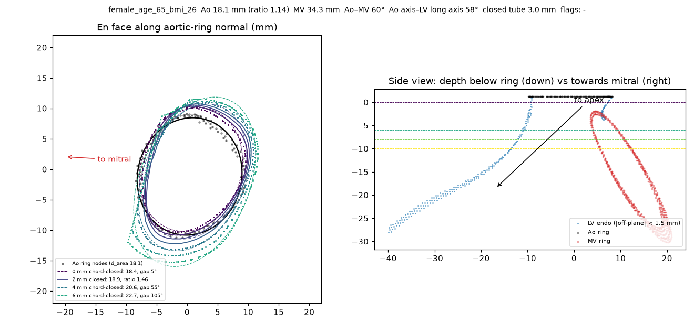

- **From mesh to outline, every step** (9 panels):
  - Code: [`scripts/08_outline_steps.py`](scripts/08_outline_steps.py)
  - Run: `$PY scripts/08_outline_steps.py female_age_65_bmi_26`

  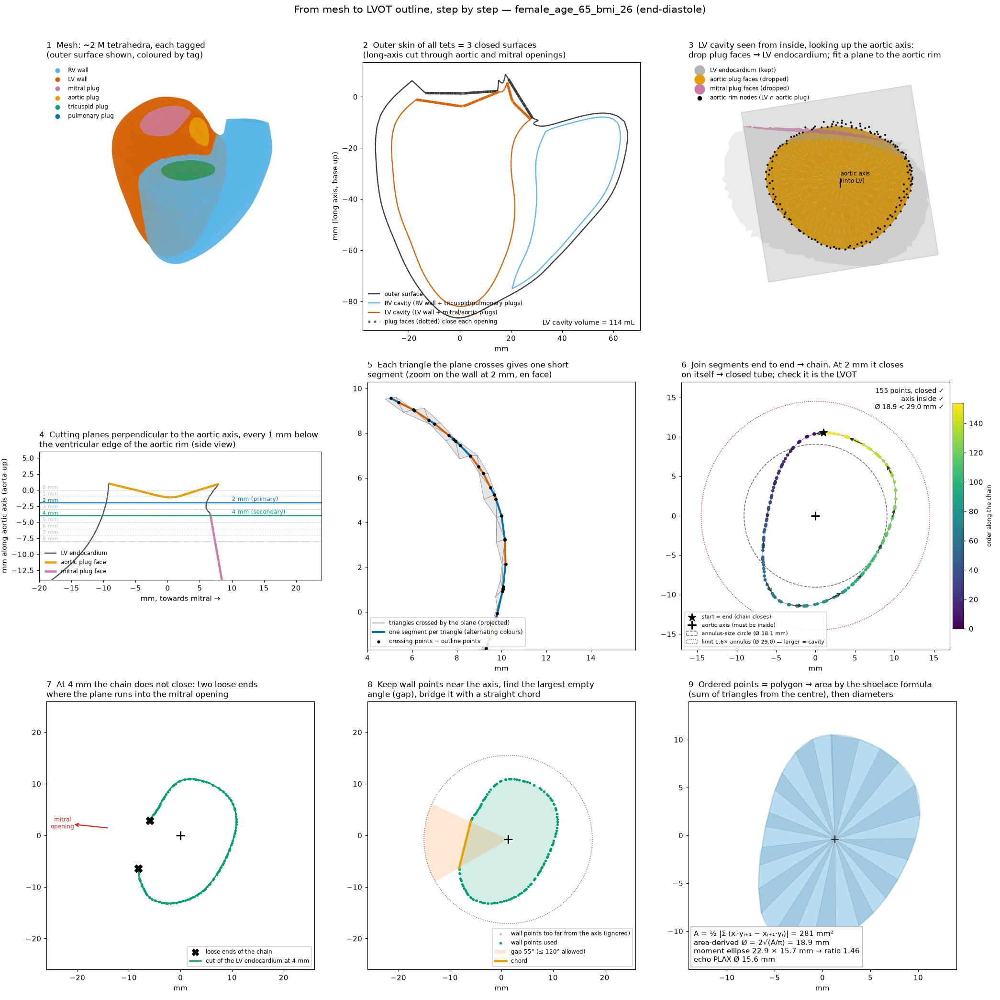

- **How one outline is made** (3D cut and en-face polygon):
  - Code: [`scripts/05_outline_demo.py`](scripts/05_outline_demo.py)
  - Run: `$PY scripts/05_outline_demo.py female_age_65_bmi_26`

  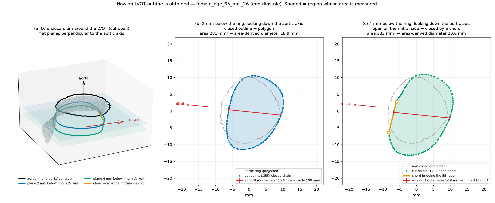

- **Chord closure of the open mitral side** (2, 4, 6 and 8 mm):
  - Code: [`scripts/04_gap_demo.py`](scripts/04_gap_demo.py)
  - Run: `$PY scripts/04_gap_demo.py female_age_65_bmi_26`

  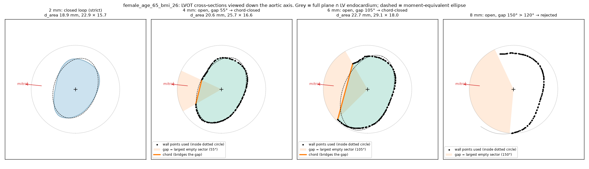

### STEP 5.6 — Save the 2D outlines (needs meshes)

- **What it does:** saves every outline (annulus, mitral ring, LVOT sections) and the PLAX directions. New area or diameter methods can then run without the meshes.
- **Code:** [`scripts/09_save_outlines.py`](scripts/09_save_outlines.py)
- **Run:** `$PY scripts/09_save_outlines.py --all` (about 65 min, resumable)
- **Output:** `data/outlines/<mesh_id>.npz` (not in git; remake with this step)

### STEP 3.0 — Which valve plug is which (needs meshes)

- **What it does:** the plug tags 4–7 have no labels in the files. This check shows that tag 5 is the aortic valve and tag 4 is the mitral valve (40 meshes).
- **Code:** [`scripts/15_plug_identity.py`](scripts/15_plug_identity.py)
- **Run:** `$PY scripts/15_plug_identity.py`
- **Output:** `outputs/tables/plug_identity.csv`

## STEP 6 — Size and shape by age and sex

### 6.1–6.5 Main analysis (tables only)

- **What it does:**
  - Applies the exclusions.
  - Indexes size to LV size (÷ EDV^⅓, and % of LV length).
  - Compares men and women in the 622 same-age, same-BMI pairs.
  - Fits `y ~ age + sex + age×sex + BMI` on all meshes.
- **Code:** [`scripts/03_analysis.py`](scripts/03_analysis.py)
- **Run:** `$PY scripts/03_analysis.py`
- **Outputs:**
  - Tables: `outputs/tables/model_coefs.csv`, `sexdiff_by_age_block.csv`, `exclusions.csv`
  - Figures: `outputs/figures/analysis/fig_raw.png` (all meshes), `fig_common.png` (matched pairs), `fig_adjusted.png` (model at BMI 27), `fig_sexdiff.png` (men − women by age)

  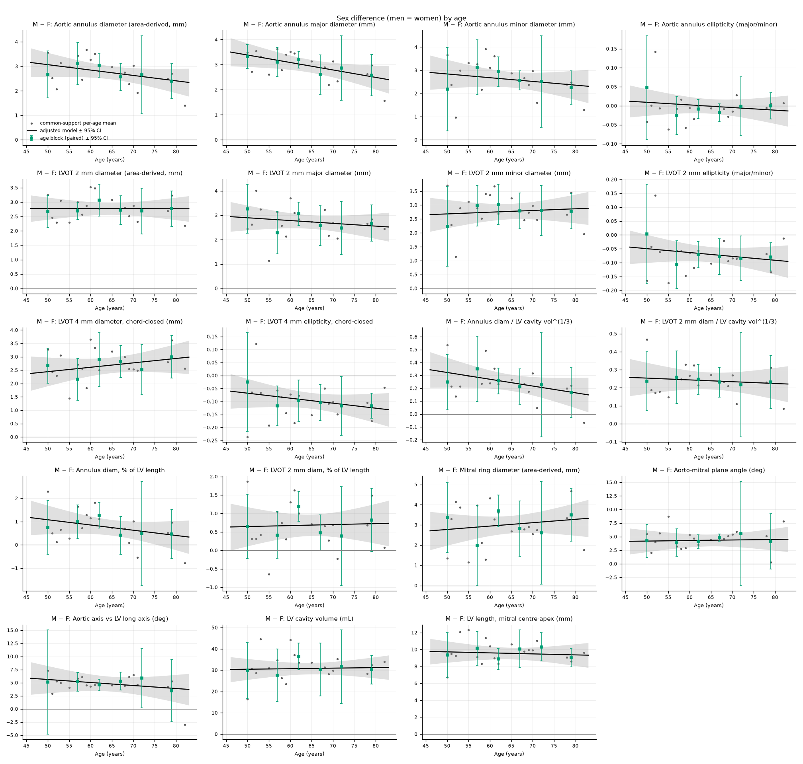

- **Main results** (medians, end-diastole):
  - LVOT 2 mm area-derived diameter: women 18.5 mm, men 21.4 mm. Men's LVOT is about 2.9 mm larger at every age.
  - Annulus ellipticity: 1.14 in both sexes (nearly round).
  - LVOT ellipticity: 1.46 (women) and 1.39 (men) at 2 mm; 1.55 and 1.44 at 4 mm. Women's LVOT is more elliptical at every age.

### 6.10 Diameter and area by age (tables only)

- **Code:** [`scripts/13_size_by_age_figure.py`](scripts/13_size_by_age_figure.py)
- **Run:** `$PY scripts/13_size_by_age_figure.py` (diameter) and `$PY scripts/13_size_by_age_figure.py --area` (area)
- **Outputs:** `outputs/figures/analysis/fig_size_by_age.png`, `fig_area_by_age.png`

  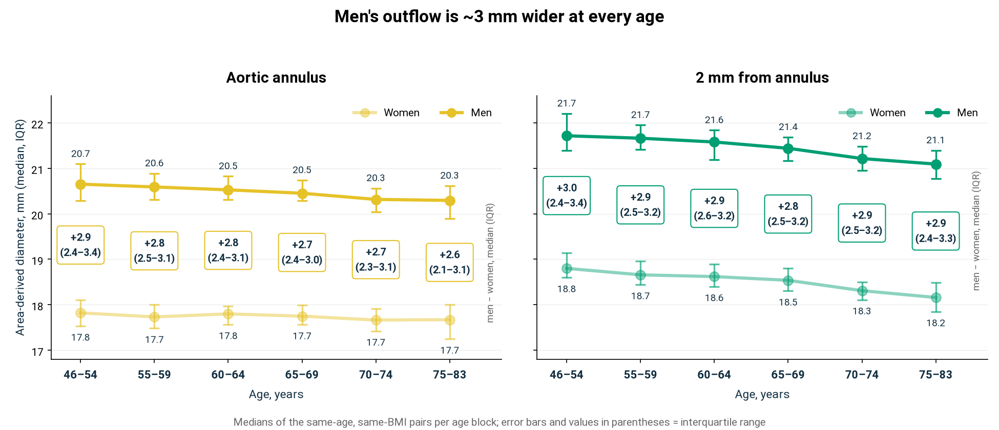

  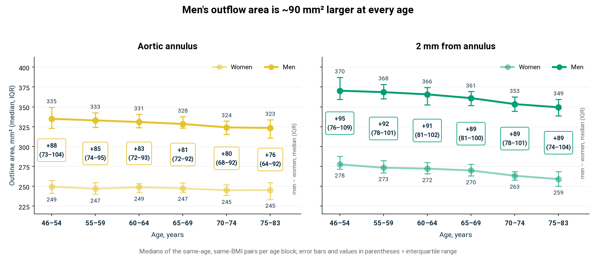

### 6.6–6.7 True area vs ellipse and echo estimates

- **What it does:** compares the measured outline area with four ellipse estimates and with the echo circle π/4·D_PLAX².
- **Code:** [`scripts/06_area_methods.py`](scripts/06_area_methods.py) (needs `data/outlines/` from STEP 5.6) and [`scripts/07_area_methods_demo.py`](scripts/07_area_methods_demo.py) (its top row re-reads one mesh)
- **Run:** `$PY scripts/06_area_methods.py`, then `$PY scripts/07_area_methods_demo.py`
- **Outputs:**
  - Tables: `outputs/tables/area_methods_summary.csv`, `area_methods_by_mesh.csv`
  - Figures: `outputs/figures/analysis/fig_area_methods.png`, `fig_area_methods_demo.png`

  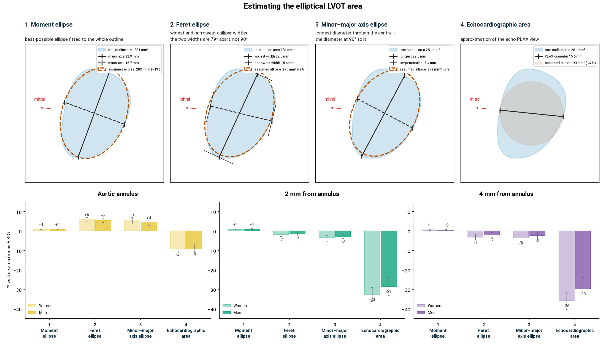

- **Result:** all ellipse estimates are within about 7% of the true area. The echo circle underestimates the LVOT area by about 30% at 2 mm (women −32.5%, men −28.8%) and by about 9% at the annulus. The error is larger in women.

### 6.8 Ellipticity by method (tables only)

- **Code:** [`scripts/10_ellipticity_methods.py`](scripts/10_ellipticity_methods.py)
- **Run:** `$PY scripts/10_ellipticity_methods.py`
- **Outputs:** `outputs/tables/ellipticity_methods.csv`, `outputs/figures/analysis/fig_ellipticity_methods.png`

  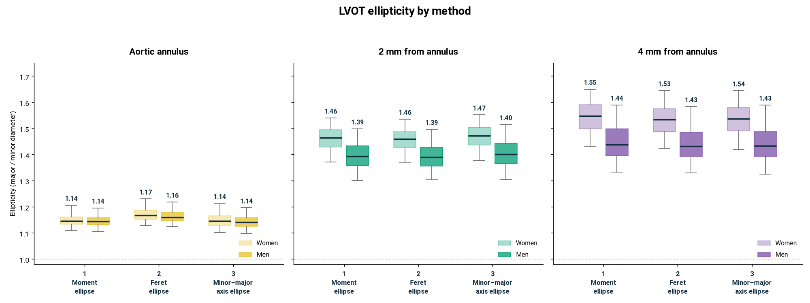

- **Result:** the three ellipse methods agree within 0.03 at every level.

### 6.9 PLAX plane definitions (needs meshes; method check, not in the main results)

- **Code:** [`scripts/11_plax_definitions.py`](scripts/11_plax_definitions.py)
- **Run:** `$PY scripts/11_plax_definitions.py` (68 meshes, about 4 min)
- **Outputs:** `outputs/tables/plax_definitions.csv`, `outputs/figures/analysis/fig_plax_definitions.png`

  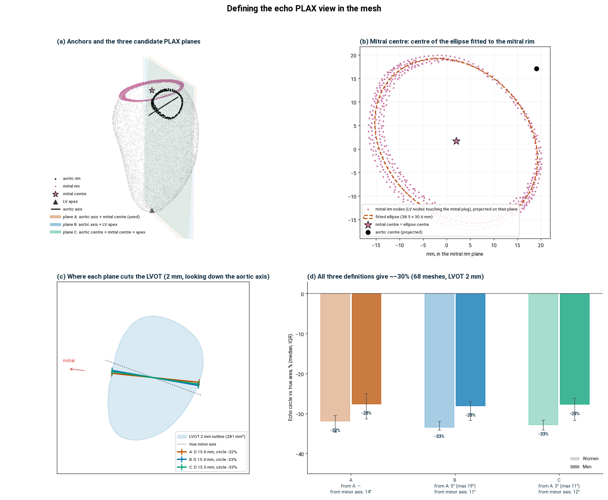

### 6.11 Aortic valve area with a circular vs elliptical LVOT (tables only)

- **What it does:** with the same VTIs, AVA scales with the LVOT area used. Correction factor k = true area / echo-circle area, applied to circular AVAs of 0.5–1.5 cm².
- **Code:** [`scripts/18_ava_simulation.py`](scripts/18_ava_simulation.py)
- **Run:** `$PY scripts/18_ava_simulation.py`
- **Outputs:** `outputs/tables/ava_correction_factors.csv`, `ava_simulation_reclassification.csv`, `outputs/figures/analysis/fig_ava_simulation.png`

  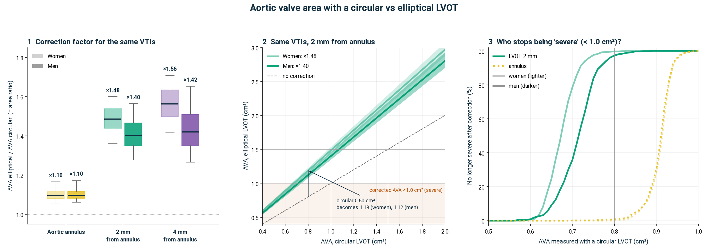

- **Result:** at 2 mm, k is 1.48 (women) and 1.40 (men). A circular AVA of 0.8 cm² becomes about 1.19 cm² (women) and 1.12 cm² (men). This is illustrative only, because the meshes are end-diastolic averages and AVA cut-offs were validated with the circular method.

## STEP 7 — Write-up, flowchart and slides

- **Write-up:** [`WRITEUP.md`](WRITEUP.md) (results and caveats).
- **Study flowchart** (tables only):
  - Code: [`scripts/14_project_flowchart.py`](scripts/14_project_flowchart.py). Run: `$PY scripts/14_project_flowchart.py`
  - Output: `outputs/figures/project_flowchart.png`

  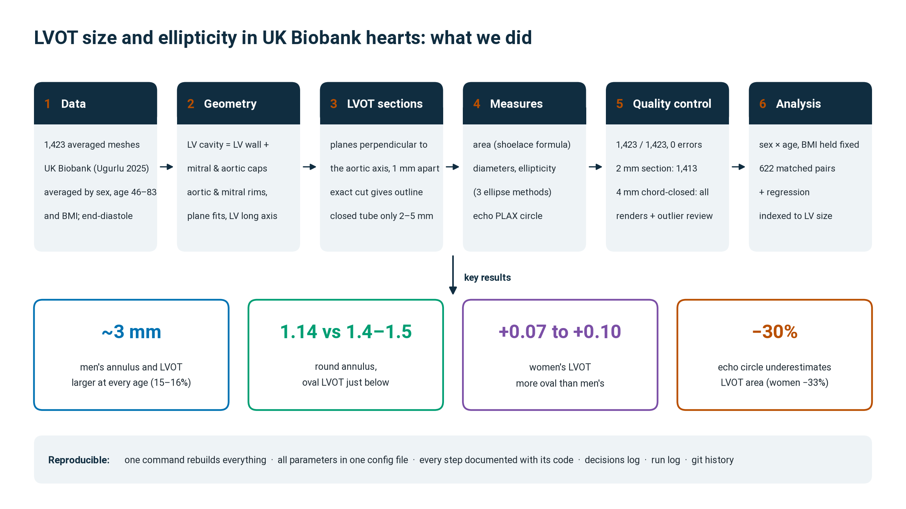

- **"What is a mesh?" figure** (needs meshes):
  - Code: [`scripts/16_mesh_explainer.py`](scripts/16_mesh_explainer.py). Run: `$PY scripts/16_mesh_explainer.py`
  - Output: `outputs/figures/mesh_explainer.png`

  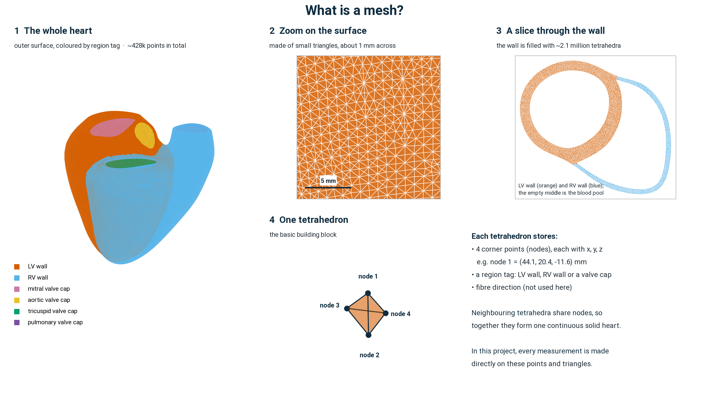

- **Ellipticity by depth and sex, slide figure** (tables only):
  - Code: [`scripts/19_ellipticity_depth_slide.py`](scripts/19_ellipticity_depth_slide.py). Run: `$PY scripts/19_ellipticity_depth_slide.py`
  - Output: `outputs/figures/slides/ellipticity_depth_{light,dark}_build{1,2}.png`

  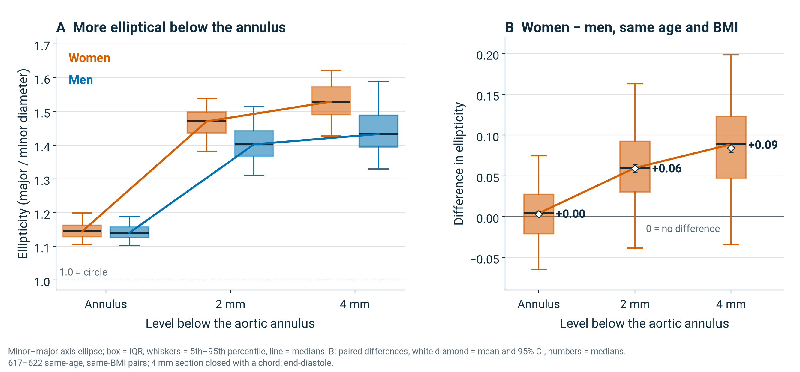

- **PowerPoint files** (optional; need Node.js and `pptxgenjs`):
  - `NODE_PATH=<folder with pptxgenjs> node scripts/12_highlights_deck.js` → `outputs/LVOT_highlights.pptx`
  - `node scripts/17_mesh_slide.js` → `outputs/slide_what_is_a_mesh.pptx`
  - `node scripts/20_ellipticity_slide.js`, then `$PY scripts/20_add_click_build.py` → `outputs/slide_ellipticity_{static,animated}.pptx`

## STEP 8 — LV and valve shape vs LVOT ellipticity (tables only, exploratory)

- **What it does:** compares shape measures (angles, mitral ring, LV length, EDV, sphericity) with LVOT ellipticity, within sex.
- **Code:** [`scripts/21_shape_vs_ellipticity.py`](scripts/21_shape_vs_ellipticity.py)
- **Run:** `$PY scripts/21_shape_vs_ellipticity.py`
- **Outputs:** `outputs/tables/shape_by_sex.csv`, `shape_vs_ellipticity.csv`, `shape_sexgap_attenuation.csv` (no figure)

## STEP 9 — Wall thickness, angles and phenotypes (exploratory)

- **9.1–9.5, measure the walls** (needs meshes):
  - What it does: measures thickness in 12 LV segments, the subaortic septum, septal bulge and the aorto-septal angle.
  - Code: [`src/wall.py`](src/wall.py) + [`scripts/22_wall_geometry.py`](scripts/22_wall_geometry.py)
  - Run: `$PY scripts/22_wall_geometry.py --all` (about 1.5 h, resumable). For the QC pictures: `$PY scripts/22_wall_geometry.py --n 40 --render 8`
  - Outputs: `outputs/tables/wall_all.csv`, `wall_subset.csv`, QC pictures in `outputs/figures/qc/wall/`

  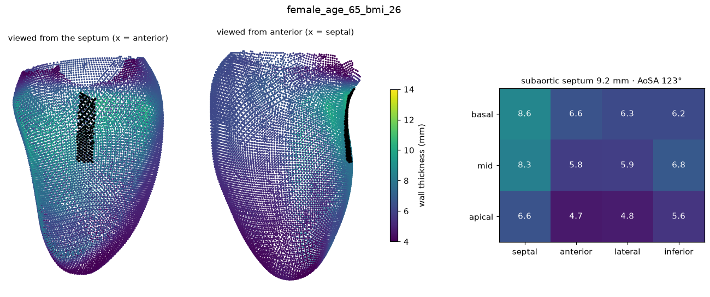

- **9.9, check the thickness method** (needs meshes):
  - Code: [`scripts/24_thickness_method_check.py`](scripts/24_thickness_method_check.py). Run: `$PY scripts/24_thickness_method_check.py`
  - Output: `outputs/tables/thickness_method_check.csv`
  - Result: perpendicular-ray thickness is 1.00–1.09 × the nearest-surface thickness, so nearest-surface is kept.
- **9.6–9.8, feature map and phenotypes** (tables only):
  - Code: [`scripts/23_wall_phenotypes.py`](scripts/23_wall_phenotypes.py). Run: `$PY scripts/23_wall_phenotypes.py`
  - Outputs: `outputs/tables/wall_all_feature_map.csv`, `wall_all_phenotypes.csv`, `wall_all_angle_continuous.csv`, `outputs/figures/analysis/fig_wall_all_feature_map.png`

  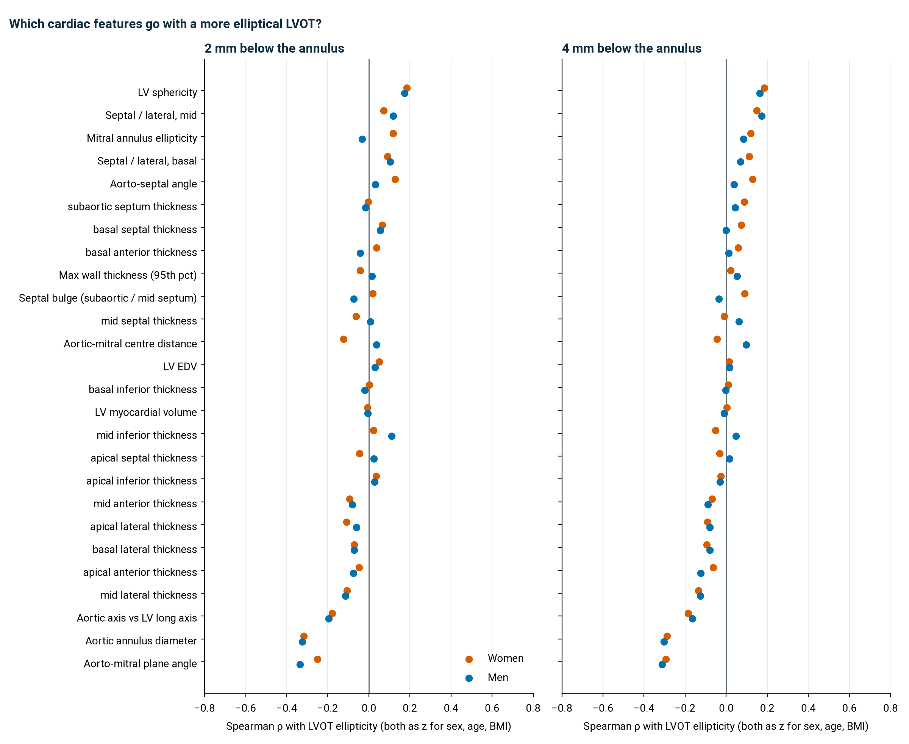

  - Result: LVOT ellipticity goes with the aorto-mitral angle (1 SD wider angle: −0.39 SD ellipticity at 4 mm, 998 normal-wall meshes), not with wall thickness (|ρ| ≤ 0.14 in every segment).

---

## Limits to state with the results

1. End-diastole only. Clinical LVOT measurements are taken in mid-systole.
2. No mitral leaflets in the meshes. The LVOT is a closed tube for only 2–5 mm.
3. Each mesh is an average of many people, so the n is 1,423 averages, not 1,423 people.
4. The annulus is where the aortic plug meets the LV, and it is not known whether this corresponds to the exact true level of the aortic valve annulus.
